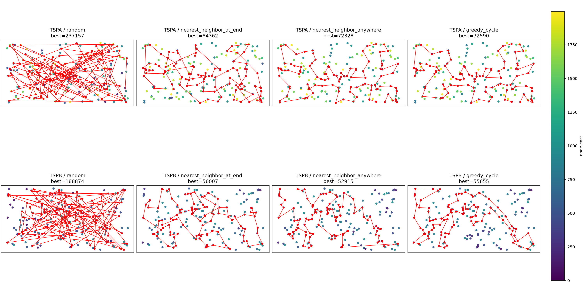
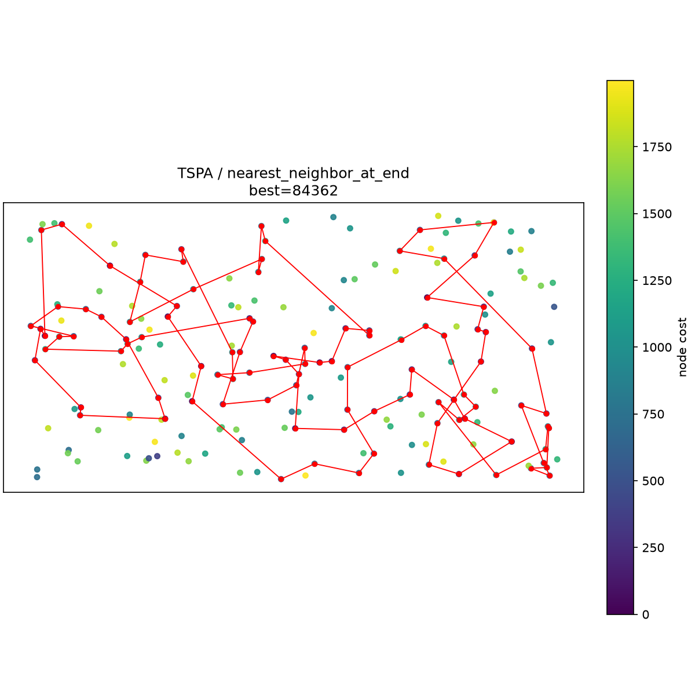
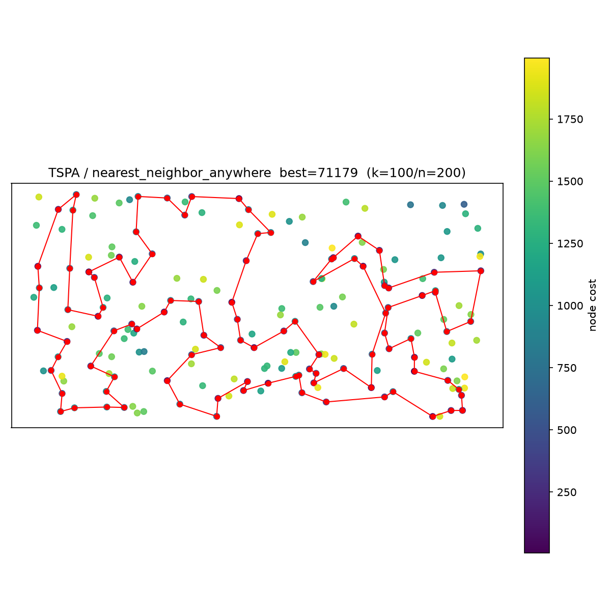
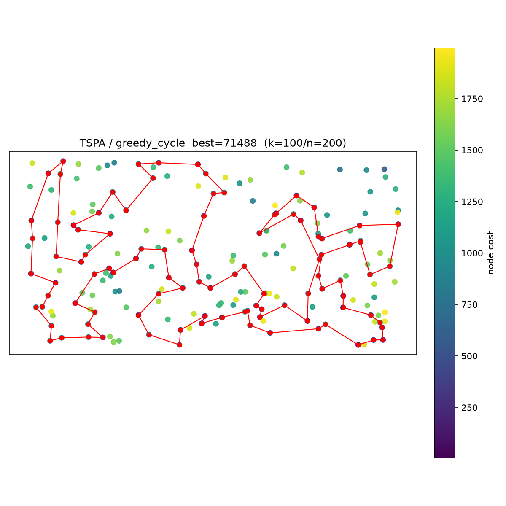
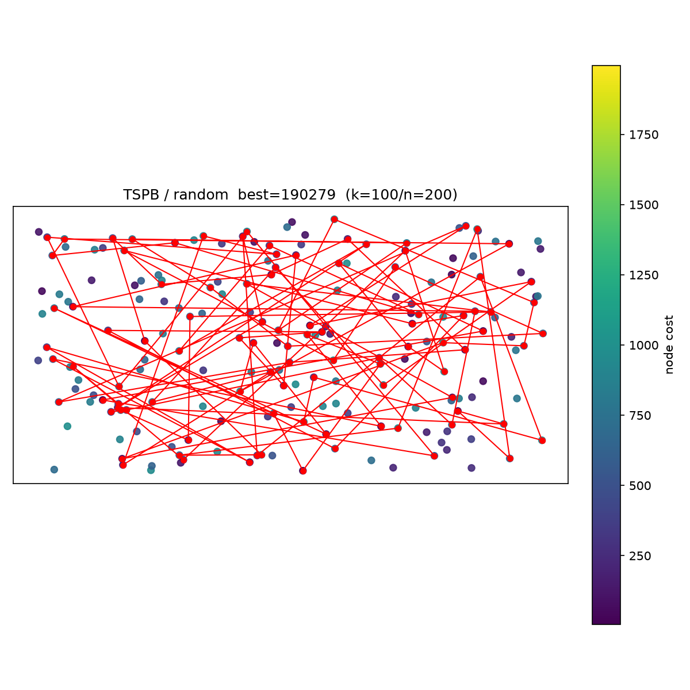
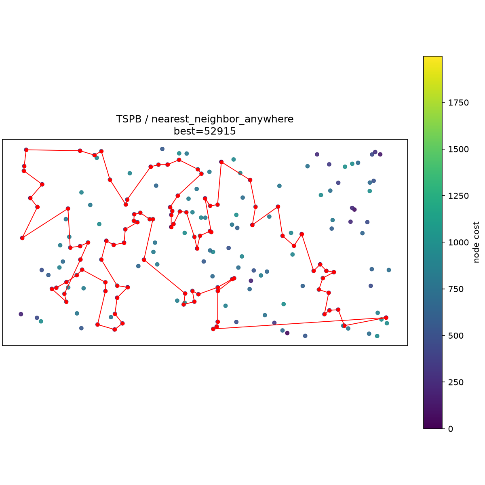

# Lab 1 — Greedy Heuristics for Selective TSP with Node Costs

## 1. Description of the problem

We are given a set of `n = 200` nodes (instances `TSPA`, `TSPB` in `data/TSPA.csv`, `data/TSPB.csv`).
Each row is `x;y;cost` (the files have no header line):

- `(x, y)` — position in the plane,
- `cost[i] >= 0` — price paid if node `i` is visited.

Goal: **select exactly `k = ceil(n/2) = 100` nodes and find a Hamiltonian cycle** 
through them minimizing:

```
f(tour) = sum_{i} dist[tour[i], tour[(i+1) mod k]] + sum_{i} cost[tour[i]]
```

where `dist` is the Euclidean distance **rounded to the nearest integer**:

```
dist[i,j] = round(sqrt((x_i-x_j)^2 + (y_i-y_j)^2))
```

Important methodological constraint:

- The distance matrix is precomputed once after loading the instance.
- Optimization methods may only access `dist` + `costs`, never `(x, y)` — so the method
  also works for pure matrix instances. Coordinates are used only for visualization.

This is a **Selective / Orienteering-like TSP**: subset selection and permutation are
optimized jointly. Node costs create a non-trivial trade-off: a cheap but remote node
can be worse than an expensive but well-located node. Hence "nearest" below is never
pure Euclidean distance.

Formally, for candidate `c` and insertion between `a -> b` (with edge `a->b` removed):

```
delta_cycle(c, a, b) = dist[a,c] + dist[c,b] - dist[a,b] + cost[c]
```

For open-path construction (nearest-neighbor variants), closure is ignored until the end;
the insertion cost is path-insertion delta (no `-dist[last,first]` term), plus `cost[c]`.

## 2. Implemented algorithms — pseudocode

Common notation: `n` nodes, select `k`, `D` distance matrix, `C` node costs, `used[]` visited flag.

### 2.1 Random solution

```text
RANDOM(n, k, rng):
    selected <- sample k distinct indices from {0..n-1} without replacement
    shuffle(selected) uniformly
    return selected as cycle order
```

### 2.2 Nearest neighbor — append at end only (`nearest_neighbor_at_end`)

Greedy open path. Start from fixed `s`, always extend the tail.

```text
NN-END(s, D, C, k):
    tour <- [s]; used[s] <- true
    repeat k-1 times:
        last <- tour.last
        best <- +inf; best_v <- -1
        for each c not used:
            value <- D[last, c] + C[c]        # edge extension + node price
            if value < best:
                best <- value; best_v <- c
        tour.append(best_v); used[best_v] <- true
    return tour   # evaluated as cycle: closing edge added in f(tour)
```

### 2.3 Nearest neighbor — insert anywhere (`nearest_neighbor_anywhere`)

Greedy open path, but each new node is inserted at the cheapest position:
before first, after last, or inside.

```text
NN-ANYWHERE(s, D, C, k):
    tour <- [s]; used[s] <- true
    repeat k-1 times:
        best_val <- +inf; best_c <- -1; best_pos <- -1
        for each c not used:
            # position 0 (prepend): D[c, tour[0]]
            # position m (append):  D[tour[m-1], c]
            # position p in 1..m-1: D[tour[p-1],c] + D[c,tour[p]] - D[tour[p-1],tour[p]]
            val_c, pos_c <- min over all positions (insertion delta, no closure)
            val_c <- val_c + C[c]
            if val_c < best_val:
                best_val <- val_c; best_c <- c; best_pos <- pos_c
        tour.insert(best_pos, best_c); used[best_c] <- true
    return tour
```


### 2.4 Greedy cycle (`greedy_cycle`)

Maintains a **closed cycle** at every step. Insertion delta accounts
for both broken edge and closure.

```text
GREEDY-CYCLE(s, D, C, k):
    tour <- [s]; used[s] <- true
    repeat k-1 times:
        if |tour| == 1:
            #  s -> c -> s
            c* <- argmin_c  2*D[s,c] + C[c]
            tour.append(c*)
        else:
            m <- |tour|
            # edges are (tour[i] -> tour[(i+1) mod m])
            best_val <- +inf; best_c <- -1; best_edge <- -1
            for each c not used:
                for each edge i:
                    val <- D[tour[i],c] + D[c,tour[(i+1) mod m]] - D[tour[i],tour[(i+1) mod m]] + C[c]
                    keep minimum over i -> val_c, edge_c
                if val_c < best_val:
                    best_val <- val_c; best_c <- c; best_edge <- edge_c
            tour.insert(best_edge+1, best_c)
        mark used
    return tour
```


## 3. Computational experiment


### 3.1 Results: min / max / mean

| instance | method | min | max | mean |
|---|---|---|---|---|
| TSPA | random | 237157 | 289146 | 263626.5 |
| TSPA | nearest_neighbor_at_end | 84362 | 90075 | 87476.6 |
| TSPA | nearest_neighbor_anywhere | **72328** | 77022 | 74347.0 |
| TSPA | greedy_cycle | 72590 | **75281** | **73793.4** |
| TSPB | random | 188874 | 232618 | 207052.8 |
| TSPB | nearest_neighbor_at_end | 56007 | **63166** | **59397.3** |
| TSPB | nearest_neighbor_anywhere | **52915** | 66164 | 59480.3 |
| TSPB | greedy_cycle | 55655 | 63734 | 59649.9 |


### 3.2 Visualization of best solutions

Common encoding in all plots: background dots = all 200 nodes, color (`viridis`) = node
cost (see colorbar); red polyline + dots = best Hamiltonian cycle for that
instance/method (closed, `k=100` nodes).

Overview grid (2 instances × 4 methods):



Individual best tours:

#### TSPA / random — best=237157


#### TSPA / nearest_neighbor_at_end — best=84362


#### TSPA / nearest_neighbor_anywhere — best=72328


#### TSPA / greedy_cycle — best=72590


#### TSPB / random — best=188874


#### TSPB / nearest_neighbor_at_end — best=56007


#### TSPB / nearest_neighbor_anywhere — best=52915


#### TSPB / greedy_cycle — best=55655


## 4. Best solutions as node index lists (0-based)

### TSPA

**random:**
```python
[12, 18, 10, 187, 168, 160, 183, 171, 99, 80, 102, 144, 172, 88, 22, 135, 4, 92, 188, 59, 62, 86, 89, 151, 50, 35, 46, 190, 123, 111, 129, 198, 152, 25, 15, 98, 74, 126, 79, 84, 31, 191, 43, 20, 23, 28, 87, 109, 186, 78, 136, 29, 145, 56, 139, 162, 130, 9, 179, 189, 27, 195, 34, 142, 3, 181, 70, 149, 39, 150, 45, 167, 108, 7, 133, 105, 124, 184, 19, 52, 51, 65, 76, 82, 132, 166, 196, 42, 5, 21, 153, 66, 36, 97, 119, 161, 180, 158, 67, 17]
```

**nearest_neighbor_at_end:**
```python
[54, 9, 33, 36, 177, 67, 144, 53, 135, 58, 134, 176, 174, 106, 89, 107, 57, 182, 151, 93, 50, 3, 1, 164, 178, 29, 136, 186, 184, 47, 159, 130, 153, 78, 88, 193, 170, 146, 75, 64, 150, 42, 113, 43, 85, 142, 8, 131, 84, 158, 192, 181, 114, 141, 180, 132, 76, 80, 48, 31, 63, 149, 168, 97, 127, 187, 30, 123, 152, 108, 60, 116, 49, 11, 119, 160, 83, 90, 51, 16, 35, 87, 45, 140, 52, 179, 185, 28, 102, 156, 157, 71, 91, 38, 100, 4, 112, 139, 115, 5]
```

**nearest_neighbor_anywhere:**
```python
[104, 129, 69, 127, 97, 168, 116, 149, 63, 11, 49, 160, 83, 123, 100, 152, 108, 60, 31, 48, 80, 91, 157, 71, 4, 76, 132, 180, 28, 102, 185, 35, 156, 51, 16, 67, 144, 140, 53, 179, 52, 177, 36, 33, 9, 54, 131, 174, 8, 164, 186, 136, 163, 29, 101, 178, 1, 169, 3, 50, 147, 47, 93, 106, 42, 89, 113, 130, 159, 146, 170, 153, 193, 78, 88, 107, 64, 57, 182, 151, 150, 176, 72, 134, 84, 58, 158, 192, 181, 114, 135, 73, 45, 87, 141, 187, 30, 189, 2, 171]
```

**greedy_cycle:**
```python
[31, 116, 149, 168, 63, 11, 49, 60, 108, 152, 100, 90, 123, 83, 160, 97, 127, 69, 171, 2, 189, 30, 187, 141, 87, 45, 73, 135, 114, 181, 192, 158, 58, 84, 134, 72, 176, 150, 151, 182, 57, 64, 107, 88, 78, 193, 153, 170, 146, 159, 130, 113, 89, 42, 106, 93, 47, 147, 50, 3, 169, 1, 178, 101, 29, 163, 136, 186, 164, 142, 8, 174, 131, 54, 9, 33, 36, 177, 52, 179, 53, 140, 144, 67, 16, 51, 156, 35, 185, 102, 28, 180, 132, 76, 4, 71, 157, 91, 80, 48]
```

### TSPB

**random:**
```python
[194, 74, 135, 84, 12, 176, 23, 80, 109, 54, 193, 72, 48, 98, 122, 111, 33, 152, 181, 175, 79, 60, 15, 121, 118, 16, 198, 70, 180, 1, 90, 55, 150, 10, 50, 160, 13, 43, 106, 8, 167, 30, 32, 147, 166, 87, 143, 0, 173, 195, 20, 117, 146, 95, 185, 66, 44, 27, 94, 99, 86, 127, 129, 83, 169, 153, 93, 97, 172, 57, 42, 151, 179, 138, 29, 59, 192, 105, 171, 159, 5, 49, 199, 7, 130, 38, 189, 123, 6, 3, 162, 161, 25, 40, 36, 156, 107, 110, 77, 18]
```

**nearest_neighbor_at_end:**
```python
[32, 89, 57, 76, 54, 127, 129, 90, 153, 20, 14, 2, 110, 118, 56, 114, 196, 10, 148, 143, 78, 192, 162, 104, 185, 184, 3, 151, 69, 172, 133, 120, 96, 121, 198, 48, 72, 46, 86, 117, 160, 136, 8, 21, 154, 140, 47, 170, 125, 177, 6, 132, 29, 197, 175, 134, 45, 60, 40, 71, 155, 97, 115, 180, 65, 28, 149, 145, 158, 116, 147, 42, 50, 130, 30, 183, 38, 64, 85, 59, 167, 51, 87, 179, 82, 88, 171, 99, 67, 24, 34, 181, 152, 73, 98, 27, 135, 75, 79, 156]
```

**nearest_neighbor_anywhere:**
```python
[110, 2, 14, 20, 74, 153, 182, 52, 90, 129, 127, 80, 54, 192, 162, 104, 76, 185, 57, 89, 86, 46, 72, 3, 184, 173, 151, 122, 117, 8, 160, 69, 172, 136, 133, 120, 156, 43, 48, 96, 198, 121, 130, 191, 50, 42, 147, 116, 37, 146, 13, 149, 28, 145, 65, 158, 177, 125, 26, 170, 197, 36, 132, 29, 6, 180, 115, 155, 71, 175, 134, 45, 157, 60, 40, 141, 97, 154, 140, 47, 38, 21, 176, 30, 183, 189, 168, 64, 59, 85, 51, 73, 167, 152, 34, 24, 181, 179, 87, 82]
```

**greedy_cycle:**
```python
[174, 36, 197, 6, 180, 115, 170, 97, 140, 47, 155, 71, 175, 134, 45, 157, 60, 141, 40, 33, 64, 21, 189, 168, 69, 160, 172, 136, 133, 120, 8, 117, 72, 46, 86, 184, 3, 173, 122, 151, 98, 111, 27, 135, 76, 185, 162, 192, 80, 52, 182, 20, 74, 2, 93, 110, 118, 14, 153, 90, 129, 127, 54, 104, 57, 89, 156, 43, 48, 96, 198, 121, 63, 130, 191, 183, 30, 176, 38, 154, 26, 125, 177, 138, 158, 145, 149, 147, 42, 116, 37, 146, 13, 28, 65, 178, 103, 29, 132, 1]
```


## 5. Solution checking


All 8 best tours were checked manually with the solution-checker spreadsheet
(`solutions/{instance}_{method}_ids.csv` pasted into `F3:F102`, total read from `K2`) and match the costs above.

```text
TSPA/random: best_ok=True best_cost=237157
TSPA/nearest_neighbor_at_end: best_ok=True best_cost=84362
TSPA/nearest_neighbor_anywhere: best_ok=True best_cost=72328
TSPA/greedy_cycle: best_ok=True best_cost=72590
TSPB/random: best_ok=True best_cost=188874
TSPB/nearest_neighbor_at_end: best_ok=True best_cost=56007
TSPB/nearest_neighbor_anywhere: best_ok=True best_cost=52915
TSPB/greedy_cycle: best_ok=True best_cost=55655
```

No duplicates, no out-of-range indices, no length violations.

## 6. Source code

https://github.com/skalskidaniel/evolutionary-computation/blob/main/lab1.ipynb

## 7. Conclusions

1. **Greedy >> random.** Even the weakest greedy (NN-END) improves over the best of
   200 random tours by 2.8× (TSPA) and 3.4× (TSPB). For this selective-TSP, blind
   sampling is not a viable strategy — geometry + costs must guide construction.
2. **Insertion position matters, but less universally than before.**
   NN-ANYWHERE beats NN-END on the best tour in both instances (TSPA -14.3%, TSPB -5.5%)
   and clearly on TSPA mean (-15.0%), while on TSPB mean the two tie (59397.3 vs 59480.3).
   Allowing interior insertions removes the forced tail order and avoids paying one huge closing edge.
3. **Cycle vs. path-anywhere is instance-dependent.** On TSPA, greedy-cycle wins on
   mean (73793.4 vs 74347.0) and worst case
   (75281 vs 77022) — more robust, less
   start-dependent. On TSPB, NN-ANYWHERE wins on best (52915 vs
   55655, -4.9%) and mean (-0.3%), while greedy-cycle keeps a better
   worst case (63734 vs 66164). No universal winner.
4. **Start-node sensitivity is real but bounded.** Greedy ranges are narrow
   (TSPA cycle: 72590–75281, about ±2%; TSPB anywhere: 52915–66164, wider, ~25% with one
   outlier tail). Multi-start (200 runs) is therefore mandatory; single-start greedy
   would be a lottery, especially on TSPB.
5. **Cost term is load-bearing.** All deltas include `+C[c]`. Without it, heuristics
   would chase pure geometry and pick dense regions. Visualizations confirm winners
   thread through low-cost regions, not just short edges.

