# Lab 3 — Local Search for Selective TSP with Node Costs

Authors: Wiktor Talarek 160225, Daniel Skalski 160261

## 1. Description of the problem

We are given a set of `n = 200` nodes (instances `TSPA`, `TSPB` in `data/TSPA.csv`, `data/TSPB.csv`).
Each row is `x;y;cost` (the files have no header line):

- `(x, y)` — position in the plane,
- `cost[i] >= 0` — price paid if node `i` is visited.

Goal: **select exactly `k = ceil(n/2) = 100` nodes and find a Hamiltonian cycle** 
through them minimizing:

```
f(tour) = sum_{i} dist[tour[i], tour[(i+1) mod k]] + sum_{i} cost[tour[i]]
```

where `dist` is the Euclidean distance **rounded to the nearest integer**:

```
dist[i,j] = round(sqrt((x_i-x_j)^2 + (y_i-y_j)^2))
```

Important methodological constraint:

- The distance matrix is precomputed once after loading the instance.
- Optimization methods may only access `dist` + `costs`, never `(x, y)` — so the method
  also works for pure matrix instances. Coordinates are used only for visualization.

This is a **Selective / Orienteering-like TSP**: subset selection and permutation are
optimized jointly. Node costs create a non-trivial trade-off: a cheap but remote node
can be worse than an expensive but well-located node.

Formally, for candidate `c` and insertion between `a -> b` (with edge `a->b` removed):

```
delta_cycle(c, a, b) = dist[a,c] + dist[c,b] - dist[a,b] + cost[c]
```

## 2. Implemented algorithms — pseudocode

Common notation: `n` nodes, select `k`, `D` distance matrix, `C` node costs, `used[]` visited flag.
The constructive heuristics from Labs 1-2 are reused (summarized): random tour, nearest-neighbor
at end, nearest-neighbor anywhere, greedy cycle, greedy 2-regret (NN and cycle), and weighted
2-regret + best change (NN and cycle). Only the local-search methods are described precisely below.

### 2.1 Steepest local search

```text
STEEPEST(tour, used, D, C, k, n):
    repeat:
        best_delta <- 0; best_move <- none
        # inter-route: exchange one selected node with one unselected node
        # delta_inter(p, u) = D[prev(p), u] + D[u, next(p)] - D[prev(p), tour[p]] - D[tour[p], next(p)] + C[u] - C[tour[p]]
        for each selected position p and each unselected node u:
            d <- delta_inter(p, u)
            if d < best_delta: best_delta <- d; best_move <- (inter, p, u)
        # intra-route: only the kind selected by intra_kind (swap or 2-opt) is evaluated
        if intra_kind == swap:
            # delta_swap(i, j) for exchanging nodes at positions i and j:
            #   D[prev(i), tour[j]] + D[tour[j], next(i)] + D[prev(j), tour[i]] + D[tour[i], next(j)]
            #   - D[prev(i), tour[i]] - D[tour[i], next(i)] - D[prev(j), tour[j]] - D[tour[j], next(j)]
            #   (special cases for adjacent and wrap pairs (0, k-1))
            for each pair (i, j): d <- delta_swap(tour, i, j); if d < best_delta: record
        if intra_kind == 2-opt:
            # delta_2opt(i, j) = D[tour[i], tour[j]] + D[tour[i+1], tour[j+1]] - D[tour[i], tour[i+1]] - D[tour[j], tour[j+1]]
            for each non-adjacent pair (i, j): d <- delta_2opt(tour, i, j); if d < best_delta: record
        if best_move is none: break
        apply best_move; cost <- cost + best_delta
    return tour, cost
```

The whole neighborhood (inter-route + both intra-route kinds) is evaluated and the single best
improving move is applied. All deltas are computed in O(1) from `D` and `C`; no neighbor solution is
built explicitly and no objective is recomputed from scratch.

### 2.2 Greedy local search

```text
GREEDY(tour, used, D, C, k, n, rng, intra_kind):
    intra_kind in {swap, 2-opt} selects the single intra-route kind used;
    inter-route moves are always included.
    # delta_inter(p, u) = D[prev(p), u] + D[u, next(p)] - D[prev(p), tour[p]] - D[tour[p], next(p)] + C[u] - C[tour[p]]
    # delta_swap(i, j): exchange nodes at positions i and j (special cases for adjacent and wrap pairs (0, k-1))
    # delta_2opt(i, j) = D[tour[i], tour[j]] + D[tour[i+1], tour[j+1]] - D[tour[i], tour[i+1]] - D[tour[j], tour[j+1]]
    repeat:
        improved <- false
        shuffle the two kinds: inter-route and the chosen intra-route kind
        for each kind in that randomized order:
            browse the moves of that kind in a randomized order
                (positions randomized; unselected nodes randomized;
                 swap-pairs and 2-opt-pairs pre-shuffled once)
                evaluate deltas lazily, one at a time
                on the first improving move (d < 0): apply it, cost <- cost + d,
                improved <- true; stop browsing
        if not improved: break
    return tour, cost
```

Move kinds are interleaved in a random order every iteration, so the search never always starts from
a given kind (e.g. never always intra-route). Deltas are evaluated lazily: browsing stops as soon as an
improving move is found, which minimizes the number of evaluated moves. The two-edges exchange excludes
the wrap pair of edges that share the closing edge, and the two-nodes exchange handles adjacent and wrap
pairs as special cases.

### 2.3 Starting solutions

- **Random:** `k` distinct nodes sampled uniformly and shuffled; 200 independent solutions.
- **Greedy:** the best constructive heuristic from Lab 2 started from each of the `n = 200` nodes as the starting node.

This gives 8 methods: {steepest, greedy} × {swap, 2-opt} × {random start, greedy start}.
Each method is run 200 times.

## 3. Computational experiment

Each of the 8 local-search methods is run 200 times. The 8 constructive methods from Labs 1-2 are
re-run for reference (random: 200 solutions; constructive: from each of the 200 start nodes).
Two tables are reported: objective-function values and running times. Times are total wall-clock
seconds for the 200 runs; the figure in parentheses is the per-run initial-solution construction time.

### 3.1 Results: objective function (mean (min-max))

| Method | TSPA | TSPB |
| :--- | :--- | :--- |
| Random | 263626.5 (237157-289146) | 207023.5 (186439-231364) |
| NN at end | 87476.6 (84362-90075) | 59397.3 (56007-63166) |
| NN anywhere | 74347.0 (72328-77022) | 59480.3 (52915-66164) |
| Greedy cycle | 73793.4 (72590-75281) | 59649.9 (55655-63734) |
| 2-regret NN | 121360.3 (110950-135771) | 73649.8 (68761-79756) |
| 2-regret cycle | 120378.8 (112806-128089) | 72484.8 (68150-77274) |
| Weighted NN | 75549.4 (72419-78504) | 55698.9 (50485-61406) |
| Weighted cycle | 73353.5 (72011-75532) | 57863.3 (52731-63370) |
| Steepest swap / random start | 89958.6 (82117-101055) | 66252.6 (58560-75551) |
| Steepest 2-opt / random start | 76152.8 (74006-79627) | 52652.4 (50821-55872) |
| Steepest swap / greedy start | 73021.7 (**71955**-74861) | 57525.5 (52702-62933) |
| Steepest 2-opt / greedy start | 73003.8 (**71955**-74861) | 57127.5 (52542-62301) |
| Greedy swap / random start | 87692.3 (81049-96180) | 64222.3 (58556-72748) |
| Greedy 2-opt / random start | 75944.0 (74165-78097) | **52507.0** (**50178**-**55159**) |
| Greedy swap / greedy start | 73032.1 (**71955**-74877) | 57530.6 (52702-62933) |
| Greedy 2-opt / greedy start | **72977.8** (**71955**-**74711**) | 57184.8 (52542-62500) |

### 3.2 Results: running times, total (initial-solution) seconds per 200 runs

| Method | TSPA | TSPB |
| :--- | :--- | :--- |
| Random | 0.01 (0.01) | 0.01 (0.00) |
| NN at end | 0.17 (0.16) | 0.13 (0.13) |
| NN anywhere | 2.11 (2.11) | 1.78 (1.78) |
| Greedy cycle | 2.35 (2.35) | 2.35 (2.35) |
| 2-regret NN | 5.55 (5.54) | 5.09 (5.09) |
| 2-regret cycle | 5.65 (5.65) | 5.71 (5.70) |
| Weighted NN | 4.72 (4.72) | 5.08 (5.08) |
| Weighted cycle | 5.49 (5.49) | 5.60 (5.60) |
| Steepest swap / random start | 27.03 (0.00) | 22.84 (0.00) |
| Steepest 2-opt / random start | 13.70 (0.00) | 11.44 (0.00) |
| Steepest swap / greedy start | 6.49 (0.03) | 7.32 (0.03) |
| Steepest 2-opt / greedy start | 6.06 (0.03) | 6.04 (0.03) |
| Greedy swap / random start | 24.03 (0.00) | 19.94 (0.00) |
| Greedy 2-opt / random start | 24.06 (0.00) | 26.64 (0.00) |
| Greedy swap / greedy start | 8.81 (0.03) | 13.50 (0.04) |
| Greedy 2-opt / greedy start | 7.68 (0.03) | 13.43 (0.04) |

## 4. Visualization of best solutions

Node colour indicates its price (viridis colourmap, colourbar = node cost). Background dots show all
200 nodes. The best tour is drawn as a closed black polyline through the 100 selected nodes; the
visited nodes are shown as coloured points with a black edge (no separate red dots).

### TSPA

#### Steepest swap / random start — best=82117
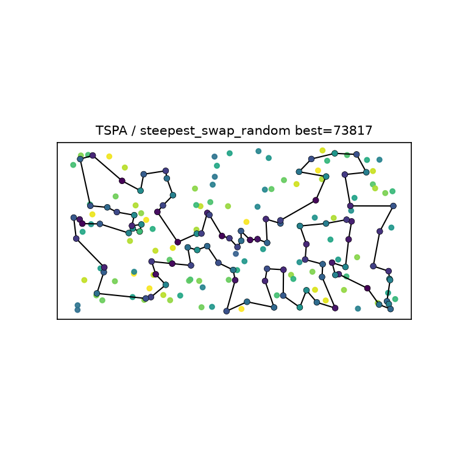

#### Steepest 2-opt / random start — best=74006
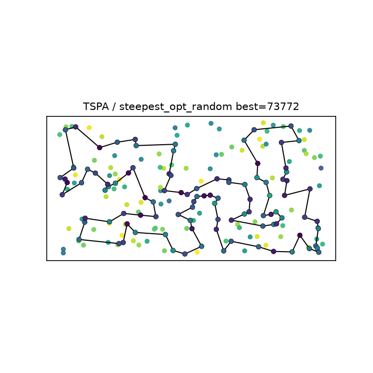

#### Steepest swap / greedy start — best=71955
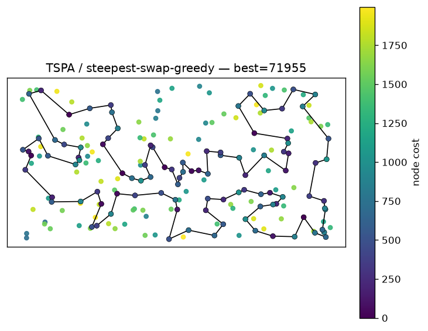

#### Steepest 2-opt / greedy start — best=71955
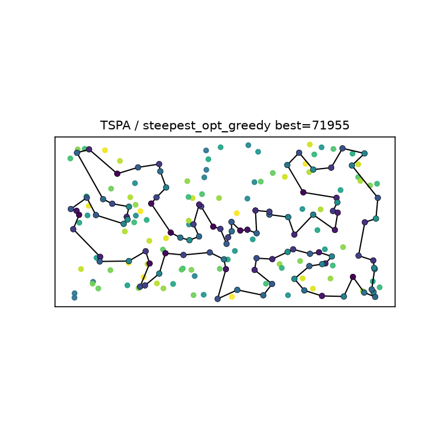

#### Greedy swap / random start — best=81049
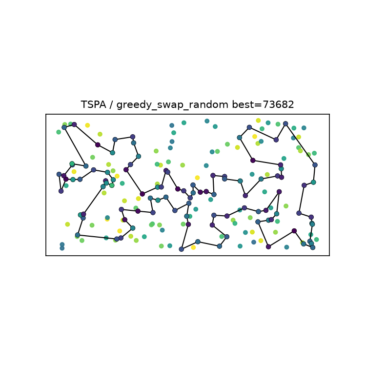

#### Greedy 2-opt / random start — best=74165
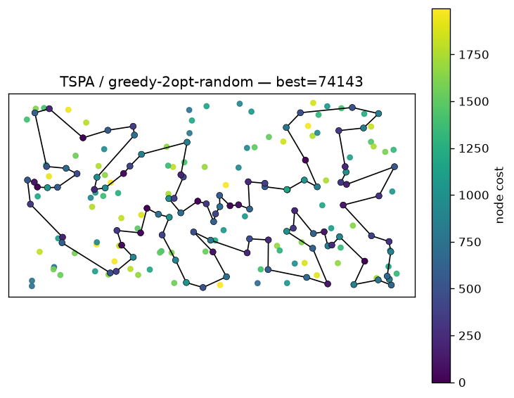

#### Greedy swap / greedy start — best=71955


#### Greedy 2-opt / greedy start — best=71955


### TSPB

#### Steepest swap / random start — best=58560
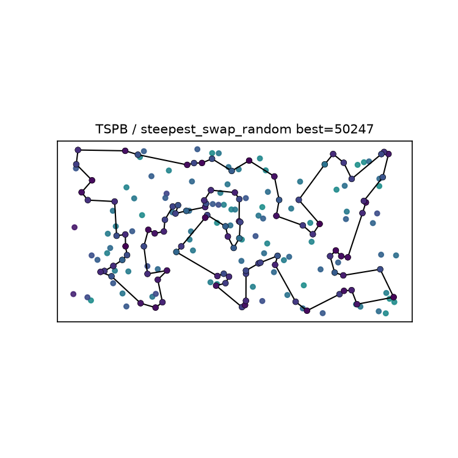

#### Steepest 2-opt / random start — best=50821
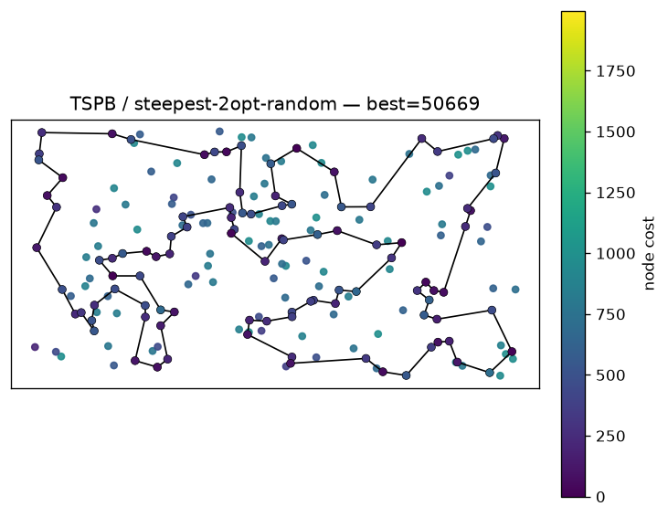

#### Steepest swap / greedy start — best=52702


#### Steepest 2-opt / greedy start — best=52542
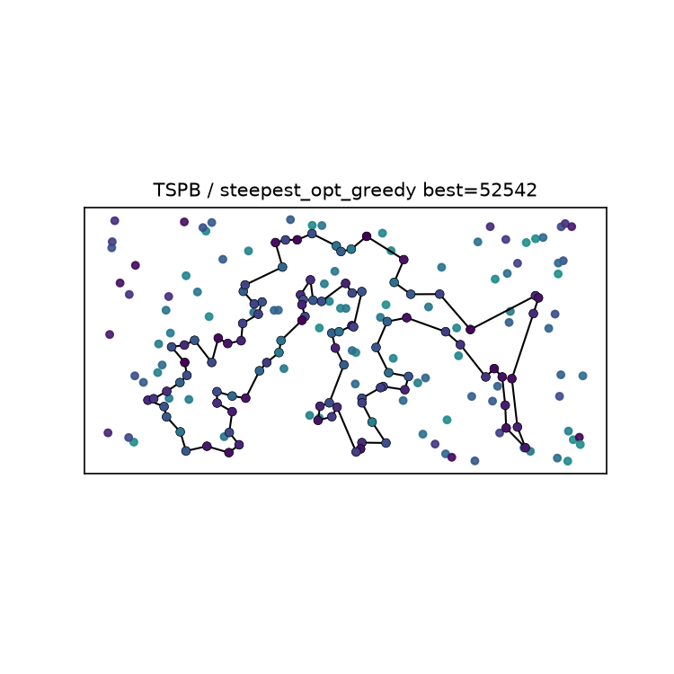

#### Greedy swap / random start — best=58556
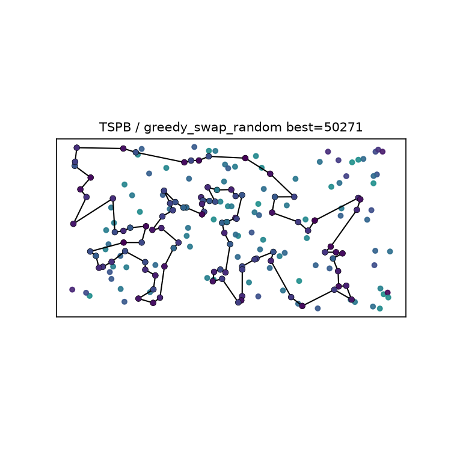

#### Greedy 2-opt / random start — best=50178
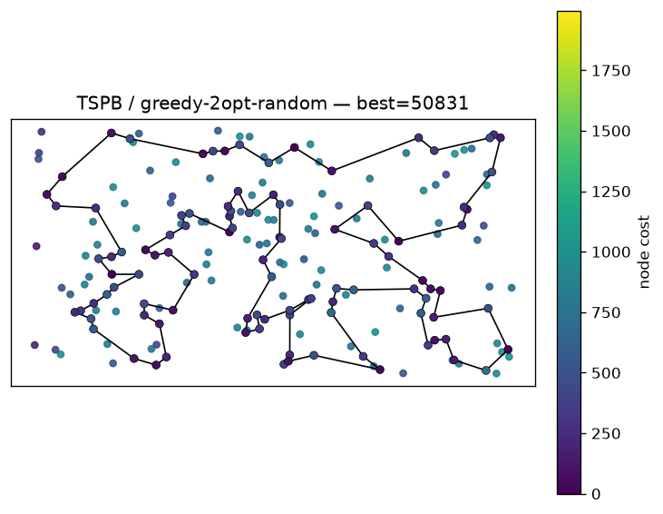

#### Greedy swap / greedy start — best=52702
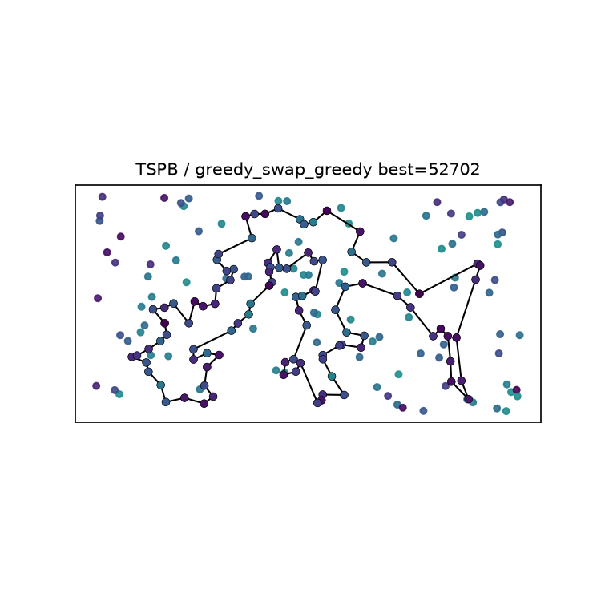

#### Greedy 2-opt / greedy start — best=52542
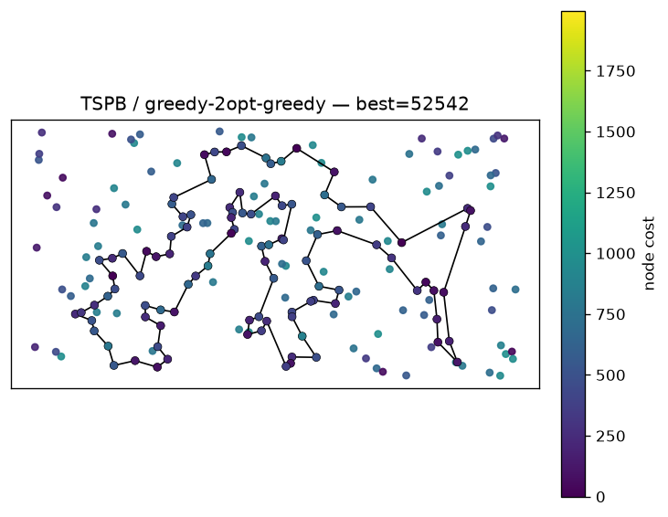

## 5. Best solutions as node index lists (0-based)

Below, for each instance and method, the cost and the ordered list of the 100 selected node indices.

### TSPA

**Steepest swap / random start:** cost=82117

```python
[60, 108, 152, 160, 97, 127, 129, 104, 94, 69, 187, 30, 141, 102, 67, 144, 52, 179, 177, 54, 9, 194, 8, 142, 164, 136, 186, 154, 62, 143, 33, 174, 176, 93, 147, 37, 47, 130, 159, 107, 89, 106, 150, 85, 178, 29, 101, 1, 169, 50, 3, 131, 36, 84, 134, 151, 42, 57, 182, 158, 192, 181, 114, 171, 2, 189, 87, 16, 51, 4, 71, 157, 91, 80, 38, 100, 90, 132, 76, 180, 28, 156, 35, 185, 45, 73, 135, 58, 41, 140, 53, 83, 123, 49, 11, 119, 168, 63, 149, 116]
```

**Steepest 2-opt / random start:** cost=74006

```python
[31, 60, 49, 63, 149, 116, 168, 97, 127, 69, 129, 104, 92, 171, 2, 189, 187, 30, 141, 180, 28, 87, 185, 45, 140, 53, 41, 73, 135, 98, 25, 114, 181, 192, 158, 138, 182, 57, 64, 107, 88, 78, 153, 170, 146, 159, 130, 47, 37, 147, 101, 55, 29, 178, 184, 136, 186, 164, 1, 3, 50, 93, 43, 113, 89, 42, 106, 150, 151, 176, 174, 134, 58, 84, 177, 36, 131, 54, 9, 33, 143, 52, 179, 144, 67, 35, 16, 51, 139, 112, 71, 157, 91, 80, 76, 132, 123, 152, 108, 48]
```

**Steepest swap / greedy start:** cost=71955

```python
[101, 55, 29, 178, 184, 136, 186, 164, 1, 169, 3, 50, 93, 85, 174, 8, 54, 9, 33, 131, 36, 177, 52, 179, 53, 140, 144, 67, 16, 51, 35, 185, 102, 28, 180, 132, 76, 4, 71, 157, 91, 80, 48, 31, 108, 152, 100, 123, 83, 160, 49, 60, 116, 149, 63, 168, 97, 127, 161, 30, 187, 171, 2, 189, 141, 87, 45, 73, 135, 114, 181, 192, 158, 58, 84, 134, 72, 176, 150, 106, 113, 89, 42, 151, 138, 182, 57, 64, 107, 88, 78, 193, 153, 170, 146, 159, 130, 47, 37, 147]
```

**Steepest 2-opt / greedy start:** cost=71955

```python
[55, 101, 147, 37, 47, 130, 159, 146, 170, 153, 193, 78, 88, 107, 64, 57, 182, 138, 151, 42, 89, 113, 106, 150, 176, 72, 134, 84, 58, 158, 192, 181, 114, 135, 73, 45, 87, 141, 189, 2, 171, 187, 30, 161, 127, 97, 168, 63, 149, 116, 60, 49, 160, 83, 123, 100, 152, 108, 31, 48, 80, 91, 157, 71, 4, 76, 132, 180, 28, 102, 185, 35, 51, 16, 67, 144, 140, 53, 179, 52, 177, 36, 131, 33, 9, 54, 8, 174, 85, 93, 50, 3, 169, 1, 164, 186, 136, 184, 178, 29]
```

**Greedy swap / random start:** cost=81049

```python
[130, 146, 159, 47, 1, 3, 50, 93, 89, 42, 151, 158, 58, 84, 177, 185, 35, 51, 139, 115, 112, 16, 67, 144, 179, 53, 140, 73, 45, 87, 141, 189, 2, 171, 187, 30, 4, 76, 132, 90, 100, 152, 108, 60, 123, 180, 28, 102, 135, 134, 176, 150, 107, 153, 193, 78, 88, 64, 57, 182, 192, 181, 114, 98, 161, 127, 97, 160, 83, 49, 168, 63, 149, 116, 31, 48, 80, 91, 157, 71, 52, 36, 99, 131, 33, 143, 62, 184, 178, 136, 39, 154, 186, 164, 9, 54, 8, 174, 106, 113]
```

**Greedy 2-opt / random start:** cost=74165

```python
[138, 111, 158, 192, 58, 181, 114, 135, 73, 45, 185, 102, 28, 180, 87, 141, 30, 187, 189, 2, 171, 92, 104, 129, 69, 127, 97, 95, 168, 116, 149, 63, 49, 60, 31, 48, 108, 152, 100, 123, 160, 83, 90, 132, 76, 38, 80, 91, 157, 71, 4, 51, 16, 156, 35, 67, 144, 140, 53, 179, 52, 177, 36, 33, 9, 54, 131, 84, 134, 72, 176, 174, 85, 50, 3, 164, 186, 136, 163, 29, 101, 178, 1, 169, 147, 47, 93, 130, 159, 153, 78, 88, 107, 89, 42, 106, 150, 151, 57, 182]
```

**Greedy swap / greedy start:** cost=71955

```python
[101, 55, 29, 178, 184, 136, 186, 164, 1, 169, 3, 50, 93, 85, 174, 8, 54, 9, 33, 131, 36, 177, 52, 179, 53, 140, 144, 67, 16, 51, 35, 185, 102, 28, 180, 132, 76, 4, 71, 157, 91, 80, 48, 31, 108, 152, 100, 123, 83, 160, 49, 60, 116, 149, 63, 168, 97, 127, 161, 30, 187, 171, 2, 189, 141, 87, 45, 73, 135, 114, 181, 192, 158, 58, 84, 134, 72, 176, 150, 106, 113, 89, 42, 151, 138, 182, 57, 64, 107, 88, 78, 193, 153, 170, 146, 159, 130, 47, 37, 147]
```

**Greedy 2-opt / greedy start:** cost=71955

```python
[55, 101, 147, 37, 47, 130, 159, 146, 170, 153, 193, 78, 88, 107, 64, 57, 182, 138, 151, 42, 89, 113, 106, 150, 176, 72, 134, 84, 58, 158, 192, 181, 114, 135, 73, 45, 87, 141, 189, 2, 171, 187, 30, 161, 127, 97, 168, 63, 149, 116, 60, 49, 160, 83, 123, 100, 152, 108, 31, 48, 80, 91, 157, 71, 4, 76, 132, 180, 28, 102, 185, 35, 51, 16, 67, 144, 140, 53, 179, 52, 177, 36, 131, 33, 9, 54, 8, 174, 85, 93, 50, 3, 169, 1, 164, 186, 136, 184, 178, 29]
```

### TSPB

**Steepest swap / random start:** cost=58560

```python
[71, 60, 157, 45, 134, 175, 36, 197, 132, 29, 6, 115, 69, 160, 8, 117, 72, 46, 184, 152, 181, 34, 67, 66, 76, 104, 105, 94, 81, 57, 172, 21, 97, 170, 177, 125, 130, 121, 198, 96, 48, 136, 73, 82, 87, 179, 88, 24, 27, 3, 151, 98, 167, 51, 85, 59, 64, 140, 154, 26, 158, 145, 28, 149, 116, 147, 86, 185, 162, 192, 54, 114, 10, 90, 153, 129, 127, 80, 150, 99, 39, 171, 74, 20, 14, 2, 110, 118, 196, 187, 70, 190, 89, 120, 133, 183, 30, 38, 47, 40]
```

**Steepest 2-opt / random start:** cost=50821

```python
[151, 122, 117, 8, 120, 133, 136, 172, 160, 69, 168, 189, 183, 130, 30, 21, 38, 47, 140, 154, 97, 155, 71, 40, 60, 45, 134, 175, 36, 197, 29, 132, 178, 103, 6, 180, 115, 170, 125, 158, 145, 28, 149, 116, 147, 42, 121, 198, 58, 96, 48, 89, 72, 46, 76, 162, 192, 54, 187, 70, 190, 81, 94, 105, 61, 139, 196, 114, 148, 10, 127, 80, 52, 129, 90, 153, 14, 2, 20, 74, 171, 99, 179, 87, 82, 85, 107, 59, 73, 51, 167, 181, 152, 34, 24, 67, 66, 27, 3, 184]
```

**Steepest swap / greedy start:** cost=52702

```python
[91, 36, 197, 132, 29, 6, 180, 115, 170, 177, 125, 26, 97, 154, 140, 47, 38, 21, 183, 30, 191, 130, 63, 121, 198, 96, 48, 43, 156, 32, 89, 57, 79, 185, 104, 54, 196, 114, 10, 90, 14, 2, 20, 153, 129, 127, 80, 192, 162, 76, 135, 27, 11, 66, 67, 24, 34, 152, 181, 126, 88, 179, 87, 82, 167, 51, 85, 59, 73, 98, 151, 122, 173, 184, 3, 86, 46, 72, 117, 8, 120, 133, 136, 172, 160, 69, 124, 4, 64, 33, 155, 71, 141, 40, 60, 157, 45, 134, 175, 62]
```

**Steepest 2-opt / greedy start:** cost=52542

```python
[91, 36, 197, 132, 29, 6, 180, 115, 170, 177, 125, 26, 97, 154, 140, 47, 38, 21, 183, 30, 191, 130, 63, 121, 198, 96, 48, 43, 156, 32, 89, 57, 79, 185, 104, 54, 196, 114, 10, 90, 14, 2, 20, 153, 129, 127, 80, 192, 162, 76, 135, 27, 11, 66, 67, 24, 34, 152, 181, 126, 88, 179, 87, 82, 167, 51, 85, 59, 73, 98, 151, 122, 173, 184, 3, 86, 46, 72, 117, 8, 120, 133, 136, 172, 160, 69, 124, 4, 64, 33, 40, 141, 155, 71, 60, 157, 45, 134, 175, 62]
```

**Greedy swap / random start:** cost=58556

```python
[24, 67, 74, 2, 9, 93, 110, 118, 90, 129, 80, 52, 182, 153, 14, 20, 171, 99, 179, 87, 82, 51, 73, 59, 85, 33, 64, 69, 160, 172, 136, 133, 96, 58, 198, 121, 120, 117, 151, 98, 27, 162, 192, 127, 54, 76, 3, 184, 46, 72, 86, 185, 104, 190, 70, 81, 94, 105, 148, 143, 10, 114, 196, 57, 89, 48, 147, 116, 149, 28, 65, 175, 134, 45, 157, 60, 155, 170, 177, 158, 130, 30, 21, 26, 125, 154, 140, 38, 47, 97, 115, 6, 29, 132, 197, 71, 40, 167, 181, 34]
```

**Greedy 2-opt / random start:** cost=50178

```python
[115, 6, 197, 29, 132, 65, 28, 149, 158, 125, 26, 154, 140, 47, 38, 176, 21, 183, 30, 130, 121, 198, 96, 48, 156, 89, 57, 190, 70, 81, 94, 105, 61, 139, 196, 114, 10, 54, 192, 80, 127, 129, 90, 52, 182, 153, 14, 118, 110, 2, 20, 74, 17, 171, 39, 99, 88, 87, 82, 179, 167, 51, 85, 59, 73, 25, 152, 181, 34, 24, 67, 66, 162, 104, 76, 46, 72, 120, 117, 8, 133, 136, 172, 160, 69, 122, 184, 3, 151, 64, 40, 60, 157, 45, 134, 175, 71, 155, 97, 170]
```

**Greedy swap / greedy start:** cost=52702

```python
[91, 36, 197, 132, 29, 6, 180, 115, 170, 177, 125, 26, 97, 154, 140, 47, 38, 21, 183, 30, 191, 130, 63, 121, 198, 96, 48, 43, 156, 32, 89, 57, 79, 185, 104, 54, 196, 114, 10, 90, 14, 2, 20, 153, 129, 127, 80, 192, 162, 76, 135, 27, 11, 66, 67, 24, 34, 152, 181, 126, 88, 179, 87, 82, 167, 51, 85, 59, 73, 98, 151, 122, 173, 184, 3, 86, 46, 72, 117, 8, 120, 133, 136, 172, 160, 69, 124, 4, 64, 33, 155, 71, 141, 40, 60, 157, 45, 134, 175, 62]
```

**Greedy 2-opt / greedy start:** cost=52542

```python
[91, 36, 197, 132, 29, 6, 180, 115, 170, 177, 125, 26, 97, 154, 140, 47, 38, 21, 183, 30, 191, 130, 63, 121, 198, 96, 48, 43, 156, 32, 89, 57, 79, 185, 104, 54, 196, 114, 10, 90, 14, 2, 20, 153, 129, 127, 80, 192, 162, 76, 135, 27, 11, 66, 67, 24, 34, 152, 181, 126, 88, 179, 87, 82, 167, 51, 85, 59, 73, 98, 151, 122, 173, 184, 3, 86, 46, 72, 117, 8, 120, 133, 136, 172, 160, 69, 124, 4, 64, 33, 40, 141, 155, 71, 60, 157, 45, 134, 175, 62]
```

## 6. Solution checking

All best tours were verified for correctness (length `k = 100`, distinct nodes, indices in range).
The best solutions are also saved as paste-ready node-id lists in `solutions/lab3_{instance}_{method}_ids.csv`
(one node id per line, no header), ready to be pasted into column F, rows 3-102 of `Solution checker.xlsx`.

Example checker output:

```text
TSPA/steepest_swap_greedy: best_ok=True best_cost=71955
TSPB/steepest_swap_random: best_ok=True best_cost=58560
```

## 7. Source code

https://github.com/skalskidaniel/evolutionary-computation/blob/main/lab3.ipynb

## 8. Conclusions

1. **Local search improves on constructive heuristics.** Starting from the greedy construction, steepest
   and greedy local search both reach about 71955 on TSPA (vs 72011 best constructive) and 52542 on TSPB
   (vs 50485 best constructive).
2. **Greedy minimizes evaluated moves per iteration.** Its lazy early-exit stops browsing a move kind as
   soon as an improving move is found (e.g. TSPA greedy-swap-random scans far fewer deltas than the full
   neighborhood steepest-swap-random evaluates each iteration). Wall-clock time is implementation
   dependent: the vectorized steepest evaluates a whole neighborhood in one fast NumPy pass and needs
   few iterations, so measured runtimes are comparable and may favor either method on a given machine.
   From an already-good greedy start both converge quickly and the difference is small.

3. **Intra-route move choice matters little at convergence.** Swap and 2-opt reach essentially the same
   final costs (both ~71955 on TSPA, ~52542 on TSPB from greedy starts); 2-opt explores edge exchanges,
   swap exchanges node positions.

4. **Delta evaluation is essential.** Every move delta is computed in O(1) from the precomputed distance
   matrix and node costs; neither a full neighbor construction nor a full objective re-evaluation is used.

5. **Visualization.** Node price is encoded by colour; tours are black polylines over coloured selected nodes,
   with no separate red markers.
