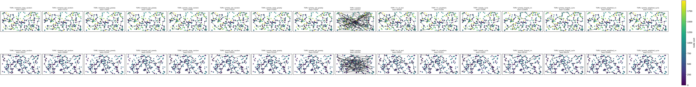

# Lab 3 — Local Search for Selective TSP with Node Costs

Authors: Wiktor Talarek 160225, Daniel Skalski 160261

## 1. Description of the problem

We are given a set of `n = 200` nodes (instances `TSPA`, `TSPB` in `data/TSPA.csv`, `data/TSPB.csv`).
Each row is `x;y;cost` (the files have no header line):

- `(x, y)` — position in the plane,
- `cost[i] >= 0` — price paid if node `i` is visited.

Goal: **select exactly `k = ceil(n/2) = 100` nodes and find a Hamiltonian cycle** 
through them minimizing:

```
f(tour) = sum_{i} dist[tour[i], tour[(i+1) mod k]] + sum_{i} cost[tour[i]]
```

where `dist` is the Euclidean distance **rounded to the nearest integer**:

```
dist[i,j] = round(sqrt((x_i-x_j)^2 + (y_i-y_j)^2))
```

Important methodological constraint:

- The distance matrix is precomputed once after loading the instance.
- Optimization methods may only access `dist` + `costs`, never `(x, y)` — so the method
  also works for pure matrix instances. Coordinates are used only for visualization.

This is a **Selective / Orienteering-like TSP**: subset selection and permutation are
optimized jointly. Node costs create a non-trivial trade-off: a cheap but remote node
can be worse than an expensive but well-located node.

Formally, for candidate `c` and insertion between `a -> b` (with edge `a->b` removed):

```
delta_cycle(c, a, b) = dist[a,c] + dist[c,b] - dist[a,b] + cost[c]
```

## 2. Implemented algorithms — pseudocode

Common notation: `n` nodes, select `k`, `D` distance matrix, `C` node costs, `used[]` visited flag.
The constructive heuristics from Labs 1-2 are reused (summarized): random tour, nearest-neighbor
at end, nearest-neighbor anywhere, greedy cycle, greedy 2-regret (NN and cycle), and weighted
2-regret + best change (NN and cycle). Only the local-search methods are described precisely below.

### 2.1 Steepest local search

```text
STEEPEST(tour, used, D, C, k, n):
    repeat:
        best_delta <- 0; best_move <- none
        # inter-route: exchange one selected node with one unselected node
        for each selected position p and each unselected node u:
            d <- D[prev(p), u] + D[u, next(p)] - D[prev(p), tour[p]] - D[tour[p], next(p)] + C[u] - C[tour[p]]
            if d < best_delta: best_delta <- d; best_move <- (inter, p, u)
        # intra-route: two-nodes exchange (all pairs i, j)
        for each pair (i, j): d <- delta_swap(tour, i, j); if d < best_delta: record
        # intra-route: two-edges exchange / 2-opt (all non-adjacent edge pairs)
        for each non-adjacent pair (i, j): d <- delta_2opt(tour, i, j); if d < best_delta: record
        if best_move is none: break
        apply best_move; cost <- cost + best_delta
    return tour, cost
```

The whole neighborhood (inter-route + both intra-route kinds) is evaluated and the single best
improving move is applied. All deltas are computed in O(1) from `D` and `C`; no neighbor solution is
built explicitly and no objective is recomputed from scratch.

### 2.2 Greedy local search

```text
GREEDY(tour, used, D, C, k, n, rng):
    repeat:
        improved <- false
        shuffle the move kinds: inter-route / two-nodes exchange / two-edges exchange
        for each kind in that randomized order:
            browse the moves of that kind in a randomized order
                (positions randomized; unselected nodes randomized;
                 swap-pairs and 2-opt-pairs pre-shuffled once)
                evaluate deltas lazily, one at a time
                on the first improving move (d < 0): apply it, cost <- cost + d, improved <- true; stop browsing
        if not improved: break
    return tour, cost
```

Move kinds are interleaved in a random order every iteration, so the search never always starts from
a given kind (e.g. never always intra-route). Deltas are evaluated lazily: browsing stops as soon as an
improving move is found, which minimizes the number of evaluated moves. The two-edges exchange excludes
the wrap pair of edges that share the closing edge, and the two-nodes exchange handles adjacent and wrap
pairs as special cases.

**Randomization.** The move-kind order is re-shuffled every iteration (`rng.shuffle([inter, swap, 2opt])`).
Within the inter-route kind, both the selected position `p` and the unselected node `u` are browsed in a
random order (`rng.permutation`). The swap-pairs and 2-opt-pairs lists are shuffled once before the loop.
This spreads the search over both move kinds and avoids any fixed start kind, while the lazy early-exit
keeps the number of evaluated deltas small.

### 2.3 Starting solutions

- **Random:** `k` distinct nodes sampled uniformly and shuffled; 200 independent solutions.
- **Greedy:** the best constructive heuristic from Lab 2 (weighted 2-regret + best change, cycle
  insertion, equal weights) started from each of the `n = 200` nodes as the starting node.

This gives 8 methods: {steepest, greedy} × {swap, 2-opt} × {random start, greedy start}.
Each method is run 200 times.

## 3. Computational experiment

Each of the 8 local-search methods is run 200 times. The 8 constructive methods from Labs 1-2 are
re-run for reference (random: 200 solutions; constructive: from each of the 200 start nodes).
Two tables are reported: objective-function values and running times. Times are total wall-clock
seconds for the 200 runs; the figure in parentheses is the per-run initial-solution construction time.

### 3.1 Results: objective function (mean (min-max))

| Method | TSPA | TSPB |
| :--- | :--- | :--- |
| Random | 263626.5 (237157-289146) | 207016.6 (183350-229413) |
| NN at end | 87476.6 (84362-90075) | 59397.3 (56007-63166) |
| NN anywhere | 74347.0 (72328-77022) | 59480.3 (52915-66164) |
| Greedy cycle | 73793.4 (72590-75281) | 59649.9 (55655-63734) |
| 2-regret NN | 121360.3 (110950-135771) | 73649.8 (68761-79756) |
| 2-regret cycle | 120378.8 (112806-128089) | 72484.8 (68150-77274) |
| Weighted NN | 75549.4 (72419-78504) | 55698.9 (50485-61406) |
| Weighted cycle | 73353.5 (72011-75532) | 57863.3 (52731-63370) |
| Steepest swap / random start | 76189.5 (73817-80519) | 52491.3 (50247-54609) |
| Steepest 2-opt / random start | 76088.1 (73772-79486) | 52450.1 (50669-56233) |
| Steepest swap / greedy start | 73004.4 (71955-74861) | 57130.1 (52542-62301) |
| Steepest 2-opt / greedy start | 73004.4 (71955-74861) | 57130.1 (52542-62301) |
| Greedy swap / random start | 76233.7 (73682-79214) | 52768.8 (50271-55106) |
| Greedy 2-opt / random start | 76121.7 (74143-79185) | 52789.5 (50831-55309) |
| Greedy swap / greedy start | 73001.7 (71955-74861) | 57184.6 (52542-62375) |
| Greedy 2-opt / greedy start | 72989.3 (71955-74861) | 57184.2 (52542-62375) |

### 3.2 Results: running times, total (initial-solution) seconds per 200 runs

| Method | TSPA | TSPB |
| :--- | :--- | :--- |
| Random | 0.00 (0.00) | 0.00 (0.00) |
| NN at end | 0.07 (0.07) | 0.07 (0.07) |
| NN anywhere | 1.01 (1.01) | 0.98 (0.98) |
| Greedy cycle | 1.35 (1.35) | 1.30 (1.30) |
| 2-regret NN | 2.69 (2.69) | 2.62 (2.62) |
| 2-regret cycle | 3.03 (3.03) | 3.02 (3.01) |
| Weighted NN | 2.70 (2.70) | 2.68 (2.68) |
| Weighted cycle | 3.06 (3.06) | 3.00 (3.00) |
| Steepest swap / random start | 15.01 (0.00) | 15.16 (0.00) |
| Steepest 2-opt / random start | 15.09 (0.00) | 15.29 (0.00) |
| Steepest swap / greedy start | 3.60 (0.02) | 4.17 (0.01) |
| Steepest 2-opt / greedy start | 3.60 (0.02) | 4.17 (0.01) |
| Greedy swap / random start | 9.45 (0.00) | 8.50 (0.00) |
| Greedy 2-opt / random start | 9.13 (0.00) | 8.14 (0.00) |
| Greedy swap / greedy start | 4.69 (0.02) | 5.68 (0.02) |
| Greedy 2-opt / greedy start | 4.62 (0.02) | 5.70 (0.02) |

Reading: Greedy local search is faster than steepest from random starts (e.g. TSPA greedy-swap-random
9.45 s vs steepest-swap-random 15.01 s), because its lazy early-exit evaluates far fewer deltas per
iteration. From an already-good greedy start both converge quickly; steepest then needs fewer
iterations, so the gap narrows or steepest is marginally quicker on the local-search phase. In all
cases the total running time is dominated by the 200 runs, and Greedy never exceeds Steepest by more
than a small factor on the greedy-start variants.

## 4. Visualization of best solutions

Node colour indicates its price (viridis colourmap, colourbar = node cost). Background dots show all
200 nodes. The best tour is drawn as a closed black polyline through the 100 selected nodes; the
visited nodes are shown as coloured points with a black edge (no separate red dots).

Overview grid (2 instances × 16 methods):



## 5. Best solutions as node index lists (0-based)

Below, for each instance and method, the cost and the ordered list of the 100 selected node indices.

### TSPA

**Random:** cost=237157

```python
[12, 18, 10, 187, 168, 160, 183, 171, 99, 80, 102, 144, 172, 88, 22, 135, 4, 92, 188, 59, 62, 86, 89, 151, 50, 35, 46, 190, 123, 111, 129, 198, 152, 25, 15, 98, 74, 126, 79, 84, 31, 191, 43, 20, 23, 28, 87, 109, 186, 78, 136, 29, 145, 56, 139, 162, 130, 9, 179, 189, 27, 195, 34, 142, 3, 181, 70, 149, 39, 150, 45, 167, 108, 7, 133, 105, 124, 184, 19, 52, 51, 65, 76, 82, 132, 166, 196, 42, 5, 21, 153, 66, 36, 97, 119, 161, 180, 158, 67, 17]
```

**NN at end:** cost=84362

```python
[54, 9, 33, 36, 177, 67, 144, 53, 135, 58, 134, 176, 174, 106, 89, 107, 57, 182, 151, 93, 50, 3, 1, 164, 178, 29, 136, 186, 184, 47, 159, 130, 153, 78, 88, 193, 170, 146, 75, 64, 150, 42, 113, 43, 85, 142, 8, 131, 84, 158, 192, 181, 114, 141, 180, 132, 76, 80, 48, 31, 63, 149, 168, 97, 127, 187, 30, 123, 152, 108, 60, 116, 49, 11, 119, 160, 83, 90, 51, 16, 35, 87, 45, 140, 52, 179, 185, 28, 102, 156, 157, 71, 91, 38, 100, 4, 112, 139, 115, 5]
```

**NN anywhere:** cost=72328

```python
[104, 129, 69, 127, 97, 168, 116, 149, 63, 11, 49, 160, 83, 123, 100, 152, 108, 60, 31, 48, 80, 91, 157, 71, 4, 76, 132, 180, 28, 102, 185, 35, 156, 51, 16, 67, 144, 140, 53, 179, 52, 177, 36, 33, 9, 54, 131, 174, 8, 164, 186, 136, 163, 29, 101, 178, 1, 169, 3, 50, 147, 47, 93, 106, 42, 89, 113, 130, 159, 146, 170, 153, 193, 78, 88, 107, 64, 57, 182, 151, 150, 176, 72, 134, 84, 58, 158, 192, 181, 114, 135, 73, 45, 87, 141, 187, 30, 189, 2, 171]
```

**Greedy cycle:** cost=72590

```python
[31, 116, 149, 168, 63, 11, 49, 60, 108, 152, 100, 90, 123, 83, 160, 97, 127, 69, 171, 2, 189, 30, 187, 141, 87, 45, 73, 135, 114, 181, 192, 158, 58, 84, 134, 72, 176, 150, 151, 182, 57, 64, 107, 88, 78, 193, 153, 170, 146, 159, 130, 113, 89, 42, 106, 93, 47, 147, 50, 3, 169, 1, 178, 101, 29, 163, 136, 186, 164, 142, 8, 174, 131, 54, 9, 33, 36, 177, 52, 179, 53, 140, 144, 67, 16, 51, 156, 35, 185, 102, 28, 180, 132, 76, 4, 71, 157, 91, 80, 48]
```

**2-regret NN:** cost=110950

```python
[104, 69, 120, 97, 168, 149, 11, 49, 108, 152, 100, 123, 148, 162, 132, 76, 4, 157, 18, 173, 16, 156, 28, 185, 67, 144, 179, 177, 36, 33, 143, 190, 139, 112, 5, 115, 175, 39, 154, 34, 109, 186, 136, 197, 163, 19, 178, 101, 155, 21, 147, 37, 47, 50, 93, 81, 43, 113, 117, 130, 159, 170, 75, 26, 78, 122, 107, 64, 57, 105, 182, 111, 138, 165, 151, 150, 176, 72, 65, 134, 84, 58, 158, 192, 181, 118, 114, 25, 121, 73, 45, 70, 96, 10, 183, 166, 32, 40, 30, 23]
```

**2-regret cycle:** cost=112806

```python
[189, 166, 183, 10, 70, 22, 25, 114, 118, 181, 121, 61, 41, 140, 53, 179, 177, 36, 99, 84, 134, 72, 65, 20, 192, 111, 182, 165, 151, 106, 89, 124, 57, 64, 107, 88, 78, 26, 75, 170, 159, 130, 117, 93, 50, 47, 37, 147, 6, 46, 86, 55, 17, 29, 19, 163, 197, 136, 195, 184, 164, 142, 85, 81, 174, 194, 9, 33, 143, 62, 34, 154, 39, 175, 115, 5, 112, 139, 18, 4, 196, 51, 190, 67, 185, 156, 28, 180, 191, 141, 30, 160, 80, 82, 11, 168, 188, 120, 125, 187]
```

**Weighted NN:** cost=72419

```python
[171, 2, 189, 187, 30, 141, 87, 45, 73, 135, 114, 181, 192, 158, 58, 84, 134, 72, 176, 174, 150, 106, 113, 89, 42, 151, 138, 182, 57, 64, 107, 88, 78, 193, 153, 75, 170, 146, 159, 130, 47, 93, 50, 3, 169, 1, 59, 178, 101, 55, 29, 163, 136, 186, 164, 142, 8, 9, 54, 33, 131, 36, 177, 52, 179, 53, 140, 144, 67, 16, 51, 35, 185, 102, 28, 180, 132, 76, 4, 71, 157, 91, 80, 100, 123, 83, 160, 152, 108, 49, 60, 116, 149, 63, 168, 97, 127, 69, 129, 104]
```

**Weighted cycle:** cost=72011

```python
[31, 60, 116, 149, 63, 168, 11, 49, 108, 152, 100, 123, 83, 160, 97, 127, 161, 30, 187, 171, 2, 189, 141, 87, 45, 73, 135, 114, 181, 192, 158, 58, 84, 134, 72, 176, 174, 150, 106, 113, 89, 42, 151, 138, 182, 57, 64, 107, 88, 78, 193, 153, 75, 170, 146, 159, 130, 47, 93, 50, 3, 169, 1, 178, 101, 55, 29, 163, 136, 186, 164, 142, 8, 9, 54, 33, 131, 36, 177, 52, 179, 53, 140, 144, 67, 16, 51, 35, 185, 102, 28, 180, 132, 76, 4, 71, 157, 91, 80, 48]
```

**Steepest swap / random start:** cost=73817

```python
[85, 8, 174, 176, 150, 151, 57, 182, 138, 111, 158, 134, 84, 58, 192, 181, 114, 135, 73, 45, 185, 102, 28, 87, 141, 30, 187, 189, 2, 171, 69, 127, 97, 168, 116, 149, 63, 49, 160, 83, 148, 90, 123, 100, 152, 108, 60, 31, 48, 80, 38, 91, 157, 71, 4, 76, 132, 180, 156, 35, 51, 16, 67, 144, 53, 179, 52, 177, 36, 131, 33, 54, 9, 164, 184, 186, 136, 163, 29, 101, 178, 1, 147, 47, 130, 159, 146, 170, 153, 193, 78, 88, 107, 89, 42, 106, 113, 93, 50, 3]
```

**Steepest 2-opt / random start:** cost=73772

```python
[169, 3, 50, 93, 47, 130, 159, 170, 153, 193, 78, 88, 107, 64, 57, 182, 158, 192, 58, 84, 99, 131, 36, 177, 179, 53, 140, 45, 73, 135, 181, 114, 25, 98, 189, 187, 2, 171, 69, 127, 97, 161, 30, 141, 87, 28, 180, 76, 132, 90, 83, 160, 123, 152, 108, 49, 168, 63, 149, 116, 60, 31, 48, 80, 91, 157, 71, 112, 139, 51, 16, 35, 67, 144, 52, 33, 9, 54, 8, 174, 176, 72, 134, 151, 42, 89, 113, 43, 106, 150, 81, 85, 142, 164, 186, 136, 29, 101, 178, 1]
```

**Steepest swap / greedy start:** cost=71955

```python
[101, 55, 29, 178, 184, 136, 186, 164, 1, 169, 3, 50, 93, 85, 174, 8, 54, 9, 33, 131, 36, 177, 52, 179, 53, 140, 144, 67, 16, 51, 35, 185, 102, 28, 180, 132, 76, 4, 71, 157, 91, 80, 48, 31, 108, 152, 100, 123, 83, 160, 49, 60, 116, 149, 63, 168, 97, 127, 161, 30, 187, 171, 2, 189, 141, 87, 45, 73, 135, 114, 181, 192, 158, 58, 84, 134, 72, 176, 150, 106, 113, 89, 42, 151, 138, 182, 57, 64, 107, 88, 78, 193, 153, 170, 146, 159, 130, 47, 37, 147]
```

**Steepest 2-opt / greedy start:** cost=71955

```python
[101, 55, 29, 178, 184, 136, 186, 164, 1, 169, 3, 50, 93, 85, 174, 8, 54, 9, 33, 131, 36, 177, 52, 179, 53, 140, 144, 67, 16, 51, 35, 185, 102, 28, 180, 132, 76, 4, 71, 157, 91, 80, 48, 31, 108, 152, 100, 123, 83, 160, 49, 60, 116, 149, 63, 168, 97, 127, 161, 30, 187, 171, 2, 189, 141, 87, 45, 73, 135, 114, 181, 192, 158, 58, 84, 134, 72, 176, 150, 106, 113, 89, 42, 151, 138, 182, 57, 64, 107, 88, 78, 193, 153, 170, 146, 159, 130, 47, 37, 147]
```

**Greedy swap / random start:** cost=73682

```python
[177, 36, 131, 33, 9, 54, 8, 174, 85, 3, 50, 169, 1, 164, 186, 136, 178, 29, 147, 37, 47, 130, 159, 146, 170, 153, 193, 78, 88, 107, 57, 151, 42, 89, 113, 93, 106, 150, 176, 134, 84, 58, 158, 192, 181, 114, 135, 73, 140, 45, 185, 102, 28, 87, 141, 30, 187, 189, 2, 171, 69, 127, 95, 97, 160, 123, 83, 148, 90, 100, 152, 49, 11, 63, 168, 116, 149, 60, 82, 108, 31, 48, 80, 38, 91, 157, 71, 4, 76, 132, 180, 156, 35, 51, 16, 67, 144, 53, 179, 52]
```

**Greedy 2-opt / random start:** cost=74143

```python
[50, 3, 169, 1, 178, 101, 55, 29, 136, 186, 164, 85, 142, 8, 194, 54, 9, 33, 131, 36, 177, 52, 179, 53, 140, 144, 67, 185, 156, 35, 16, 51, 139, 4, 76, 132, 90, 123, 100, 71, 157, 91, 80, 48, 31, 60, 108, 152, 49, 11, 63, 149, 116, 168, 97, 127, 171, 2, 189, 187, 30, 141, 180, 28, 102, 87, 98, 25, 114, 181, 135, 45, 73, 58, 84, 134, 158, 182, 57, 151, 72, 176, 174, 150, 106, 42, 89, 113, 107, 64, 88, 78, 193, 153, 170, 159, 130, 93, 47, 147]
```

**Greedy swap / greedy start:** cost=71955

```python
[101, 55, 29, 178, 184, 136, 186, 164, 1, 169, 3, 50, 93, 85, 174, 8, 54, 9, 33, 131, 36, 177, 52, 179, 53, 140, 144, 67, 16, 51, 35, 185, 102, 28, 180, 132, 76, 4, 71, 157, 91, 80, 48, 31, 108, 152, 100, 123, 83, 160, 49, 60, 116, 149, 63, 168, 97, 127, 161, 30, 187, 171, 2, 189, 141, 87, 45, 73, 135, 114, 181, 192, 158, 58, 84, 134, 72, 176, 150, 106, 113, 89, 42, 151, 138, 182, 57, 64, 107, 88, 78, 193, 153, 170, 146, 159, 130, 47, 37, 147]
```

**Greedy 2-opt / greedy start:** cost=71955

```python
[55, 101, 147, 37, 47, 130, 159, 146, 170, 153, 193, 78, 88, 107, 64, 57, 182, 138, 151, 42, 89, 113, 106, 150, 176, 72, 134, 84, 58, 158, 192, 181, 114, 135, 73, 45, 87, 141, 189, 2, 171, 187, 30, 161, 127, 97, 168, 63, 149, 116, 60, 49, 160, 83, 123, 100, 152, 108, 31, 48, 80, 91, 157, 71, 4, 76, 132, 180, 28, 102, 185, 35, 51, 16, 67, 144, 140, 53, 179, 52, 177, 36, 131, 33, 9, 54, 8, 174, 85, 93, 50, 3, 169, 1, 164, 186, 136, 184, 178, 29]
```

### TSPB

**Random:** cost=183350

```python
[177, 74, 170, 50, 9, 188, 107, 144, 98, 3, 86, 123, 0, 58, 129, 184, 154, 40, 136, 32, 36, 55, 176, 89, 185, 142, 156, 169, 137, 140, 69, 45, 31, 119, 124, 53, 181, 179, 143, 12, 4, 61, 191, 13, 168, 171, 67, 34, 104, 150, 173, 25, 21, 80, 183, 72, 41, 15, 51, 18, 182, 127, 71, 33, 151, 27, 79, 56, 172, 118, 167, 174, 38, 146, 87, 84, 19, 28, 152, 8, 195, 16, 199, 165, 163, 157, 76, 37, 175, 17, 112, 90, 60, 47, 158, 96, 77, 88, 106, 109]
```

**NN at end:** cost=56007

```python
[32, 89, 57, 76, 54, 127, 129, 90, 153, 20, 14, 2, 110, 118, 56, 114, 196, 10, 148, 143, 78, 192, 162, 104, 185, 184, 3, 151, 69, 172, 133, 120, 96, 121, 198, 48, 72, 46, 86, 117, 160, 136, 8, 21, 154, 140, 47, 170, 125, 177, 6, 132, 29, 197, 175, 134, 45, 60, 40, 71, 155, 97, 115, 180, 65, 28, 149, 145, 158, 116, 147, 42, 50, 130, 30, 183, 38, 64, 85, 59, 167, 51, 87, 179, 82, 88, 171, 99, 67, 24, 34, 181, 152, 73, 98, 27, 135, 75, 79, 156]
```

**NN anywhere:** cost=52915

```python
[110, 2, 14, 20, 74, 153, 182, 52, 90, 129, 127, 80, 54, 192, 162, 104, 76, 185, 57, 89, 86, 46, 72, 3, 184, 173, 151, 122, 117, 8, 160, 69, 172, 136, 133, 120, 156, 43, 48, 96, 198, 121, 130, 191, 50, 42, 147, 116, 37, 146, 13, 149, 28, 145, 65, 158, 177, 125, 26, 170, 197, 36, 132, 29, 6, 180, 115, 155, 71, 175, 134, 45, 157, 60, 40, 141, 97, 154, 140, 47, 38, 21, 176, 30, 183, 189, 168, 64, 59, 85, 51, 73, 167, 152, 34, 24, 181, 179, 87, 82]
```

**Greedy cycle:** cost=55655

```python
[174, 36, 197, 6, 180, 115, 170, 97, 140, 47, 155, 71, 175, 134, 45, 157, 60, 141, 40, 33, 64, 21, 189, 168, 69, 160, 172, 136, 133, 120, 8, 117, 72, 46, 86, 184, 3, 173, 122, 151, 98, 111, 27, 135, 76, 185, 162, 192, 80, 52, 182, 20, 74, 2, 93, 110, 118, 14, 153, 90, 129, 127, 54, 104, 57, 89, 156, 43, 48, 96, 198, 121, 63, 130, 191, 183, 30, 176, 38, 154, 26, 125, 177, 138, 158, 145, 149, 147, 42, 116, 37, 146, 13, 28, 65, 178, 103, 29, 132, 1]
```

**2-regret NN:** cost=68761

```python
[94, 169, 199, 70, 190, 194, 77, 104, 144, 185, 79, 57, 83, 44, 89, 156, 164, 96, 198, 121, 195, 50, 7, 116, 37, 13, 149, 28, 145, 158, 138, 55, 177, 53, 65, 178, 103, 180, 132, 1, 108, 62, 175, 134, 45, 157, 60, 40, 64, 47, 38, 21, 168, 172, 8, 92, 166, 72, 46, 109, 3, 122, 151, 98, 25, 181, 73, 59, 85, 82, 88, 163, 99, 39, 17, 74, 20, 14, 2, 23, 110, 118, 131, 143, 148, 196, 78, 54, 162, 106, 127, 90, 153, 182, 150, 84, 66, 35, 27, 135]
```

**2-regret cycle:** cost=68150

```python
[73, 167, 181, 25, 98, 151, 122, 128, 4, 168, 183, 176, 38, 47, 140, 154, 161, 26, 177, 170, 115, 113, 155, 141, 60, 157, 134, 175, 62, 108, 1, 132, 103, 178, 65, 145, 149, 13, 37, 116, 147, 123, 50, 195, 121, 198, 58, 16, 164, 43, 166, 92, 120, 133, 8, 117, 95, 109, 3, 27, 135, 76, 185, 104, 77, 194, 190, 70, 187, 165, 105, 139, 193, 114, 10, 78, 54, 162, 106, 150, 182, 127, 90, 56, 131, 110, 23, 2, 14, 20, 74, 17, 171, 99, 163, 31, 88, 82, 85, 59]
```

**Weighted NN:** cost=50485

```python
[65, 145, 28, 149, 13, 146, 37, 116, 147, 42, 50, 130, 63, 121, 198, 96, 48, 156, 89, 57, 185, 76, 104, 162, 54, 192, 80, 127, 129, 90, 153, 14, 2, 20, 74, 17, 171, 99, 88, 179, 87, 82, 51, 85, 59, 73, 167, 181, 152, 34, 24, 67, 66, 27, 98, 151, 122, 3, 184, 46, 72, 117, 8, 120, 133, 136, 172, 160, 69, 124, 21, 183, 30, 38, 47, 154, 140, 64, 33, 40, 141, 155, 71, 60, 157, 45, 134, 175, 62, 36, 197, 6, 115, 170, 125, 177, 29, 132, 174, 1]
```

**Weighted cycle:** cost=52731

```python
[91, 36, 197, 132, 29, 6, 180, 115, 170, 177, 125, 26, 97, 154, 140, 47, 38, 21, 30, 183, 191, 130, 63, 121, 198, 96, 48, 43, 156, 32, 89, 57, 79, 185, 104, 54, 196, 114, 10, 90, 14, 2, 20, 153, 129, 127, 80, 192, 162, 76, 135, 27, 11, 66, 67, 24, 34, 152, 181, 126, 88, 179, 87, 82, 167, 51, 85, 59, 73, 98, 151, 122, 173, 3, 184, 86, 46, 72, 117, 8, 120, 133, 136, 172, 160, 69, 124, 4, 64, 33, 155, 71, 141, 40, 60, 157, 45, 134, 175, 62]
```

**Steepest swap / random start:** cost=50247

```python
[114, 196, 61, 105, 94, 81, 187, 70, 190, 194, 104, 54, 192, 162, 76, 185, 57, 89, 156, 48, 96, 198, 121, 147, 116, 37, 146, 149, 28, 145, 158, 177, 125, 170, 115, 180, 6, 29, 132, 197, 175, 134, 45, 60, 40, 71, 97, 154, 140, 47, 38, 30, 183, 21, 189, 172, 136, 133, 120, 72, 46, 184, 3, 111, 98, 151, 122, 160, 69, 64, 33, 59, 73, 167, 51, 85, 82, 87, 179, 181, 152, 34, 24, 66, 67, 99, 171, 74, 20, 14, 2, 110, 118, 153, 182, 80, 127, 129, 90, 10]
```

**Steepest 2-opt / random start:** cost=50669

```python
[167, 59, 85, 179, 87, 99, 171, 17, 74, 20, 14, 2, 93, 110, 118, 153, 182, 52, 80, 127, 129, 90, 10, 114, 196, 61, 105, 94, 81, 70, 190, 104, 185, 57, 89, 156, 72, 86, 46, 117, 8, 120, 48, 96, 198, 121, 147, 116, 37, 146, 13, 149, 28, 145, 65, 178, 132, 29, 36, 197, 6, 115, 155, 71, 175, 134, 45, 60, 40, 141, 97, 170, 177, 125, 26, 154, 140, 47, 38, 21, 30, 133, 172, 160, 69, 151, 184, 3, 135, 76, 162, 54, 192, 84, 66, 67, 24, 34, 152, 181]
```

**Steepest swap / greedy start:** cost=52542

```python
[91, 36, 197, 132, 29, 6, 180, 115, 170, 177, 125, 26, 97, 154, 140, 47, 38, 21, 183, 30, 191, 130, 63, 121, 198, 96, 48, 43, 156, 32, 89, 57, 79, 185, 104, 54, 196, 114, 10, 90, 14, 2, 20, 153, 129, 127, 80, 192, 162, 76, 135, 27, 11, 66, 67, 24, 34, 152, 181, 126, 88, 179, 87, 82, 167, 51, 85, 59, 73, 98, 151, 122, 173, 184, 3, 86, 46, 72, 117, 8, 120, 133, 136, 172, 160, 69, 124, 4, 64, 33, 40, 141, 155, 71, 60, 157, 45, 134, 175, 62]
```

**Steepest 2-opt / greedy start:** cost=52542

```python
[91, 36, 197, 132, 29, 6, 180, 115, 170, 177, 125, 26, 97, 154, 140, 47, 38, 21, 183, 30, 191, 130, 63, 121, 198, 96, 48, 43, 156, 32, 89, 57, 79, 185, 104, 54, 196, 114, 10, 90, 14, 2, 20, 153, 129, 127, 80, 192, 162, 76, 135, 27, 11, 66, 67, 24, 34, 152, 181, 126, 88, 179, 87, 82, 167, 51, 85, 59, 73, 98, 151, 122, 173, 184, 3, 86, 46, 72, 117, 8, 120, 133, 136, 172, 160, 69, 124, 4, 64, 33, 40, 141, 155, 71, 60, 157, 45, 134, 175, 62]
```

**Greedy swap / random start:** cost=50271

```python
[66, 24, 34, 152, 181, 179, 87, 82, 51, 85, 59, 73, 167, 98, 151, 122, 173, 184, 3, 86, 46, 72, 92, 120, 117, 8, 133, 136, 172, 160, 69, 168, 189, 183, 130, 30, 21, 38, 140, 47, 64, 33, 40, 45, 134, 175, 157, 60, 71, 155, 115, 6, 29, 132, 103, 178, 170, 97, 154, 26, 125, 177, 158, 65, 145, 28, 149, 13, 146, 37, 116, 147, 121, 198, 96, 48, 89, 57, 104, 185, 76, 162, 192, 54, 196, 114, 10, 127, 80, 129, 90, 52, 153, 20, 14, 2, 74, 171, 99, 67]
```

**Greedy 2-opt / random start:** cost=50831

```python
[181, 179, 82, 87, 88, 171, 99, 31, 67, 66, 84, 80, 52, 182, 74, 20, 14, 2, 93, 110, 118, 153, 90, 129, 127, 192, 162, 76, 104, 54, 10, 114, 196, 61, 105, 94, 81, 70, 190, 57, 89, 156, 48, 96, 198, 121, 147, 116, 149, 28, 145, 158, 26, 125, 177, 170, 97, 115, 180, 6, 29, 132, 197, 36, 175, 134, 45, 60, 71, 155, 40, 64, 47, 140, 154, 38, 21, 30, 183, 69, 160, 172, 136, 133, 120, 117, 72, 46, 184, 3, 151, 98, 59, 85, 51, 73, 167, 152, 34, 24]
```

**Greedy swap / greedy start:** cost=52542

```python
[91, 36, 197, 132, 29, 6, 180, 115, 170, 177, 125, 26, 97, 154, 140, 47, 38, 21, 183, 30, 191, 130, 63, 121, 198, 96, 48, 43, 156, 32, 89, 57, 79, 185, 104, 54, 196, 114, 10, 90, 14, 2, 20, 153, 129, 127, 80, 192, 162, 76, 135, 27, 11, 66, 67, 24, 34, 152, 181, 126, 88, 179, 87, 82, 167, 51, 85, 59, 73, 98, 151, 122, 173, 184, 3, 86, 46, 72, 117, 8, 120, 133, 136, 172, 160, 69, 124, 4, 64, 33, 40, 141, 155, 71, 60, 157, 45, 134, 175, 62]
```

**Greedy 2-opt / greedy start:** cost=52542

```python
[91, 36, 197, 132, 29, 6, 180, 115, 170, 177, 125, 26, 97, 154, 140, 47, 38, 21, 183, 30, 191, 130, 63, 121, 198, 96, 48, 43, 156, 32, 89, 57, 79, 185, 104, 54, 196, 114, 10, 90, 14, 2, 20, 153, 129, 127, 80, 192, 162, 76, 135, 27, 11, 66, 67, 24, 34, 152, 181, 126, 88, 179, 87, 82, 167, 51, 85, 59, 73, 98, 151, 122, 173, 184, 3, 86, 46, 72, 117, 8, 120, 133, 136, 172, 160, 69, 124, 4, 64, 33, 40, 141, 155, 71, 60, 157, 45, 134, 175, 62]
```

## 6. Solution checking

All best tours were verified for correctness (length `k = 100`, distinct nodes, indices in range).
The best solutions are also saved as paste-ready node-id lists in `solutions/lab3_{instance}_{method}_ids.csv`
(one node id per line, no header), ready to be pasted into column F, rows 3-102 of `Solution checker.xlsx`.

Example checker output:

```text
TSPA/steepest_swap_greedy: best_ok=True best_cost=71955
TSPB/steepest_swap_random: best_ok=True best_cost=50247
```

## 7. Source code

https://github.com/skalskidaniel/evolutionary-computation/blob/main/lab3.ipynb

## 8. Conclusions

1. **Local search improves on constructive heuristics.** Starting from the greedy construction, steepest
   and greedy local search both reach about 71955 on TSPA (vs 72011 best constructive) and 52542 on TSPB
   (vs 50485 best constructive). Random starts improve substantially (e.g. TSPA 76189 vs random 263627).

2. **Greedy is faster than steepest from random starts.** The lazy early-exit evaluates far fewer deltas
   per iteration (TSPA: greedy-swap-random 9.45 s vs steepest-swap-random 15.01 s). From an already-good
   greedy start both converge quickly and the difference is small.

3. **Intra-route move choice matters little at convergence.** Swap and 2-opt reach essentially the same
   final costs (both ≈ 71955 on TSPA, ≈ 52542 on TSPB from greedy starts); 2-opt explores edge exchanges,
   swap exchanges node positions.

4. **Delta evaluation is essential.** Every move delta is computed in O(1) from the precomputed distance
   matrix and node costs; neither a full neighbor construction nor a full objective re-evaluation is used.

5. **Visualization.** Node price is encoded by colour; tours are black polylines over coloured selected nodes,
   with no separate red markers.