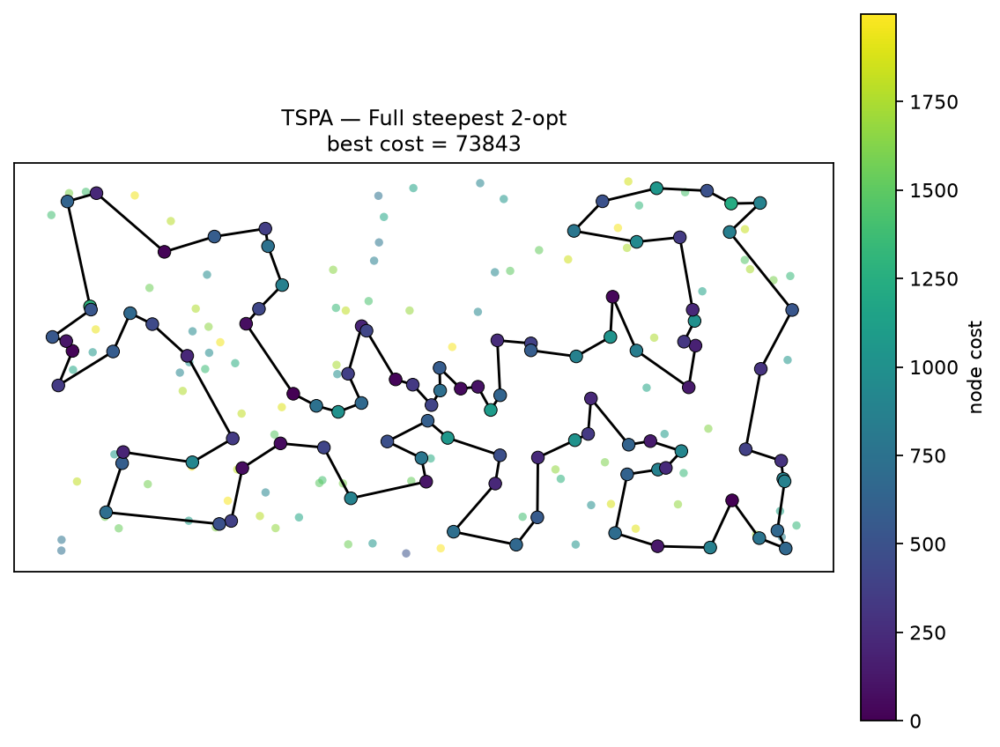
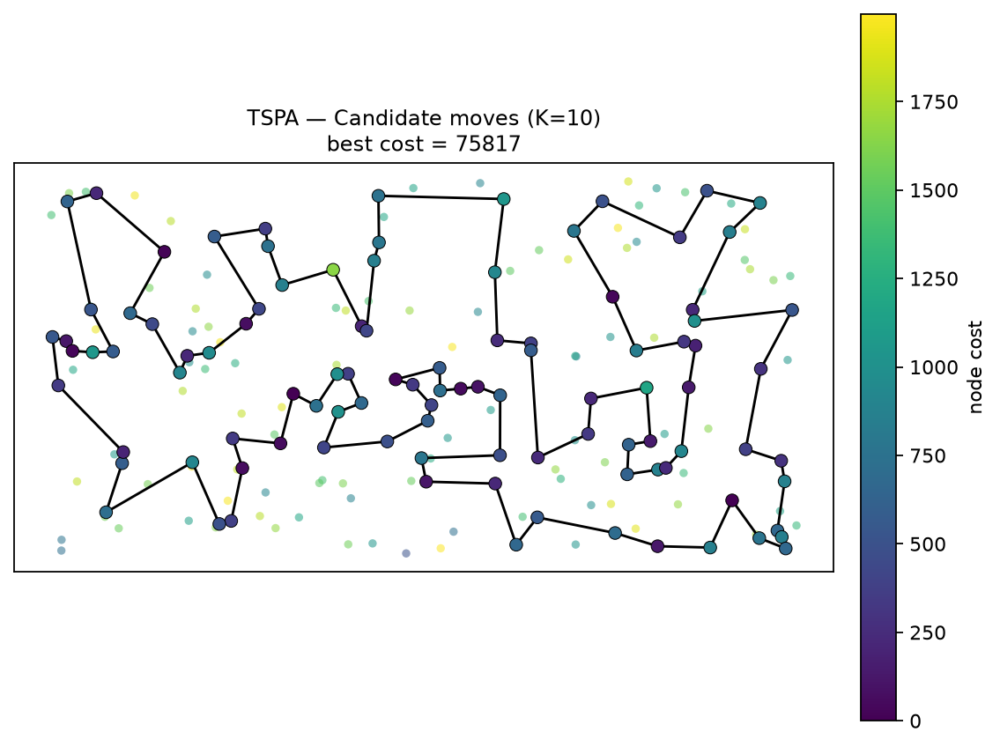
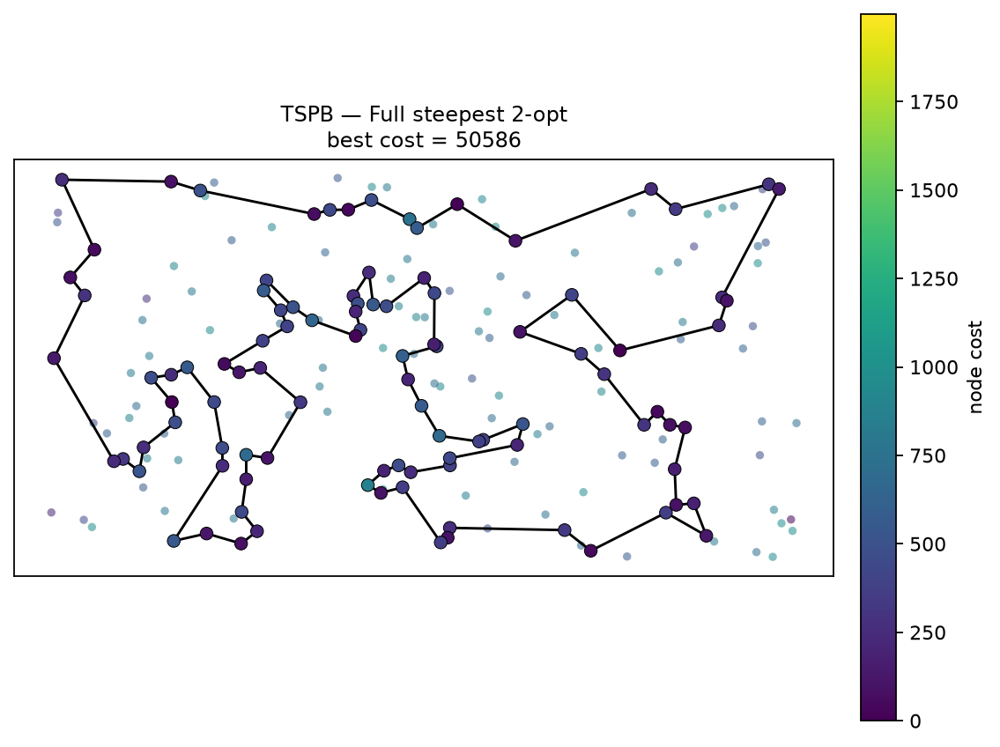
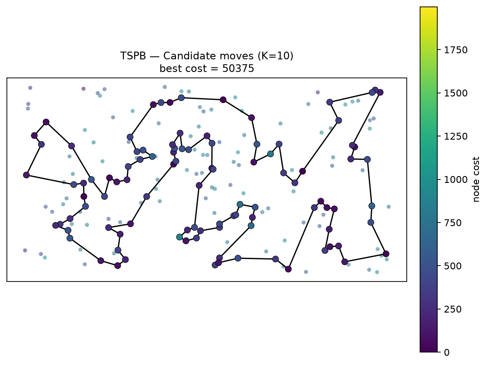

# Lab 4 — Candidate Moves in Steepest Local Search for Selective TSP with Node Costs

Authors: Wiktor Talarek 160225, Daniel Skalski 160261

## 1. Description of the problem

We are given a set of `n = 200` nodes (instances `TSPA`, `TSPB` in `data/TSPA.csv`, `data/TSPB.csv`).
Each row is `x;y;cost` (the files have no header line):

- `(x, y)` — position in the plane,
- `cost[i] >= 0` — price paid if node `i` is visited.

Goal: **select exactly `k = ceil(n/2) = 100` nodes and find a Hamiltonian cycle** through them minimizing:

```
f(tour) = sum_i dist[tour[i], tour[(i+1) mod k]] + sum_i cost[tour[i]]
```

where `dist` is the Euclidean distance **rounded to the nearest integer**:

```
dist[i,j] = round(sqrt((x_i-x_j)^2 + (y_i-y_j)^2))
```

Methodological constraints (same as in Labs 1-3):

- The distance matrix is precomputed once after loading the instance.
- Optimization methods access only `dist` and `costs`, never `(x, y)`. Coordinates are used only for
  visualization.
- Every move delta is computed in `O(1)`; no neighbour solution is built explicitly and the objective
  is never recomputed from scratch inside the search.

This is a **Selective / Orienteering-like TSP**: subset selection and permutation are optimized jointly.
Node costs create a trade-off: a cheap but remote node can be worse than an expensive but well-located
one. For this reason "nearest" in the candidate lists is never pure Euclidean distance.

## 2. Implemented algorithms — pseudocode

Common notation: `n` nodes, select `k`, `D` distance matrix, `C` node costs, `used[]` visited flag,
`tour[]` the current cyclic tour.

The neighbourhood used in this assignment is the one that proved best in Lab 3:
**2-opt intra-route moves + inter-route node exchange**. Lab 4 compares two versions of the steepest
local search using this neighbourhood:

1. the full steepest local search (baseline, no candidate mechanism),
2. the steepest local search restricted to candidate moves (the Lab 4 method).

### 2.1 Candidate edges and candidate moves

For each vertex `i`, the candidate list `cand[i]` contains the `K` vertices `j != i` minimizing

```
score(i, j) = D[i,j] + C[j]
```

Adding `C[i]` would only add a constant to every score in row `i`, so it would not change the ranking;
`score` therefore accounts for both the edge length and the cost of the candidate vertex. The default is
`K = 10`; other values are tested in Section 3.4. Candidate lists are built once per instance and do not
depend on the current tour. The lists are directed: a move is considered when its candidate endpoint `v`
belongs to the list of the selected anchor `p`, exactly following the suggested two-level loop.

A **candidate move** is a move that introduces at least one candidate edge `(p, v)`, i.e. an edge with
`v in cand[p]`. For a given candidate edge `(p, v)` there are two possible moves of each type:

- **Intra-route (2-opt), `v` selected:**
  - **A:** remove edges `(p, p_next)` and `(v, v_next)`, add `(p, v)` and `(p_next, v_next)`;
  - **B:** remove edges `(p_prev, p)` and `(v_prev, v)`, add `(p_prev, v_prev)` and `(p, v)`.
- **Inter-route (node exchange), `v` unselected:**
  - **A:** insert `v` after `p` and remove `p_next` (the new edge `(p, v)` is added);
  - **B:** insert `v` before `p` and remove `p_prev` (the new edge `(v, p)` is added).

Both orientations are evaluated. The inter-route move is a node exchange: one selected node leaves the
tour and one unselected node enters it, but the new node is always inserted **next to the selected
anchor `p`**, so the candidate edge `(p, v)` is actually added. Simply replacing a selected node by one
of its nearest neighbours in the same position would not necessarily add a candidate edge.

### 2.2 Baseline: full steepest local search

```text
STEEPEST_FULL(tour, used, D, C, k, n):
    repeat:
        best_delta <- 0; best_move <- none
        # inter-route: exchange one selected node with one unselected node
        for each selected position p and each unselected node u:
            d <- D[prev(p),u] + D[u,next(p)] - D[prev(p),tour[p]] - D[tour[p],next(p)]
                 + C[u] - C[tour[p]]
            if d < best_delta: best_delta <- d; best_move <- (inter, p, u)
        # intra-route: 2-opt (two-edges exchange)
        for each non-adjacent pair (i,j):
            d <- D[tour[i],tour[j]] + D[tour[i+1],tour[j+1]]
                 - D[tour[i],tour[i+1]] - D[tour[j],tour[j+1]]
            if d < best_delta: best_delta <- d; best_move <- (2opt, i, j)
        if best_move is none: break
        apply best_move; cost <- cost + best_delta
    return tour, cost
```

The whole neighbourhood is scanned at every iteration. With `k = 100` and `n = 200` this is
`k(n-k) = 10 000` inter-route deltas plus `4 850` 2-opt deltas per iteration.

### 2.3 Candidate steepest local search

```text
CANDIDATE_STEEPEST(tour, used, D, C, k, n, cand):
    pos[v] <- position of v in tour for every selected v
    repeat:
        best_delta <- 0; best_move <- none
        for each selected position i (p <- tour[i]):
            for each v in cand[p]:
                if used[v]:
                    # 2-opt A, valid if v != p_next and v_next != p
                    d <- D[p,v] + D[p_next,v_next] - D[p,p_next] - D[v,v_next]
                    if d < best_delta: best_delta <- d; best_move <- (2opt_A, i, v)
                    # 2-opt B, valid if p_prev != v and v_prev != p
                    d <- D[p_prev,v_prev] + D[p,v] - D[p_prev,p] - D[v_prev,v]
                    if d < best_delta: best_delta <- d; best_move <- (2opt_B, i, v)
                else:
                    # inter A: insert v after p, remove p_next
                    d <- D[p,v] + D[v,p_next_next] - D[p,p_next] - D[p_next,p_next_next]
                         + C[v] - C[p_next]
                    if d < best_delta: best_delta <- d; best_move <- (inter_A, i, v)
                    # inter B: insert v before p, remove p_prev
                    d <- D[p_prev_prev,v] + D[v,p] - D[p_prev_prev,p_prev] - D[p_prev,p]
                         + C[v] - C[p_prev]
                    if d < best_delta: best_delta <- d; best_move <- (inter_B, i, v)
        if best_move is none: break
        apply best_move; update tour, used, pos; cost <- cost + best_delta
    return tour, cost
```

The outer loop visits only the `k` selected nodes; the inner loop visits only the `K` candidate vertices
of each selected node. Thus at most `2kK` moves are evaluated per iteration (`2 000` for `K = 10`),
instead of about `14 850`. The full neighbourhood is never scanned and no move is tested only to reject
it as "not a candidate".

Tie-breaking is deterministic: the first minimum returned by the vectorized evaluation is used. The only
randomness in the experiment is the random starting solution: `k` distinct nodes are sampled uniformly
without replacement and shuffled. Candidate lists are deterministic.

## 3. Computational experiment

### 3.1 Setup

- 200 random starting solutions per instance.
- **The same 200 starting solutions are used for every method**, so the comparison is paired.
- Candidate lists are built once per instance and per `K`.
- Times are total wall-clock seconds for all 200 runs and include the random-start construction and the
  candidate-list construction. The figure in parentheses is the mean initial-solution construction time
  per run.
- The main comparison uses `K = 10`; `K in {5, 10, 15, 20, 30}` is tested in Section 3.4.

### 3.2 Results: objective function, mean (min-max)

| Method | TSPA | TSPB |
| :--- | :--- | :--- |
| Full steepest 2-opt (baseline) | **76278.1** (73843-79671) | 52598.8 (50586-55376) |
| Candidate steepest 2-opt, K=5 | 86582.1 (80405-92972) | 54235.7 (51457-57457) |
| Candidate steepest 2-opt, K=10 | 80227.0 (75817-85267) | 52632.8 (**50375**-55376) |
| Candidate steepest 2-opt, K=15 | 77513.1 (74527-81370) | 52569.6 (50561-55439) |
| Candidate steepest 2-opt, K=20 | 76585.7 (73998-81924) | 52628.6 (50814-55401) |
| Candidate steepest 2-opt, K=30 | 76301.0 (**73827**-83021) | **52546.5** (50455-55376) |

With `K = 10` the mean objective is about 5.2% worse on TSPA and essentially the same on TSPB
(0.06% worse). The best TSPB solution found by the candidate method (50375) is better than the best
baseline solution (50586). Increasing `K` closes the quality gap.

### 3.3 Results: running times, total (initial-solution) seconds per 200 runs

| Method | TSPA | TSPB |
| :--- | :--- | :--- |
| Full steepest 2-opt (baseline) | 24.13 (0.0001) | 25.82 (0.0001) |
| Candidate steepest 2-opt, K=5 | **5.59** (0.0001) | **6.42** (0.0001) |
| Candidate steepest 2-opt, K=10 | 7.93 (0.0001) | 8.90 (0.0001) |
| Candidate steepest 2-opt, K=15 | 9.86 (0.0001) | 10.68 (0.0001) |
| Candidate steepest 2-opt, K=20 | 11.74 (0.0001) | 12.55 (0.0001) |
| Candidate steepest 2-opt, K=30 | 16.65 (0.0001) | 16.39 (0.0001) |

Speed-up of the main method (`K = 10`) relative to the full steepest search:

| Instance | Full steepest | Candidate K=10 | Speed-up |
| :--- | :--- | :--- | :--- |
| TSPA | 24.13 s | 7.93 s | **3.04x** |
| TSPB | 25.82 s | 8.90 s | **2.90x** |

The candidate method evaluates about `252 000` (TSPA) and `265 000` (TSPB) move deltas per run, whereas
the full steepest search evaluates about `2.0` million per run (about 135 iterations x 14 850 moves).
This is roughly an **8x reduction in evaluated moves**; the measured wall-clock speed-up is about 3x
because the baseline is vectorized and each of its iterations processes a large array in one NumPy pass.

### 3.4 Choice of K

| K | TSPA mean (min-max) | TSPA total [s] | TSPA speed-up | TSPB mean (min-max) | TSPB total [s] | TSPB speed-up |
| :--- | :--- | :--- | :--- | :--- | :--- | :--- |
| 5 | 86582.1 (80405-92972) | 5.59 | 4.32x | 54235.7 (51457-57457) | 6.42 | 4.02x |
| **10** | **80227.0** (75817-85267) | **7.93** | **3.04x** | **52632.8** (50375-55376) | **8.90** | **2.90x** |
| 15 | 77513.1 (74527-81370) | 9.86 | 2.45x | 52569.6 (50561-55439) | 10.68 | 2.42x |
| 20 | 76585.7 (73998-81924) | 11.74 | 2.06x | 52628.6 (50814-55401) | 12.55 | 2.06x |
| 30 | 76301.0 (73827-83021) | 16.65 | 1.45x | 52546.5 (50455-55376) | 16.39 | 1.57x |

`K = 5` is the fastest but visibly degrades quality, especially on TSPA. `K = 15` and `K = 20` recover
most of the quality but lose much of the speed advantage. `K = 10` is a good compromise and is kept as
the default. On TSPB the quality is almost insensitive to `K >= 10`.

## 4. Visualization of the best solutions

Node colour encodes the node cost. The colour scale is the same in all figures
(`viridis`, `vmin = 0`, `vmax = 1997`, the global minimum and maximum node cost over both instances),
and every figure has its own colorbar with the actual cost values. Background dots are all 200 nodes;
the selected 100 nodes are coloured points with a black edge, connected by a closed black polyline.

The figures are presented separately, one below another.

### TSPA

#### Full steepest 2-opt — best = 73843



#### Candidate moves, K=10 — best = 75817



### TSPB

#### Full steepest 2-opt — best = 50586



#### Candidate moves, K=10 — best = 50375



## 5. Best solutions as node index lists (0-based)

### TSPA

**Full steepest 2-opt:** cost=73843

```python
[82, 31, 48, 80, 91, 157, 71, 4, 76, 132, 180, 28, 102, 185, 35, 51, 16, 67, 144, 53, 179, 52, 177, 36, 99, 131, 33, 9, 54, 8, 142, 164, 85, 93, 50, 3, 169, 1, 178, 184, 186, 136, 163, 29, 17, 55, 101, 147, 47, 130, 159, 146, 170, 153, 78, 88, 107, 64, 57, 182, 151, 42, 89, 113, 106, 150, 174, 176, 72, 134, 158, 192, 181, 58, 84, 41, 140, 45, 73, 135, 98, 87, 141, 187, 2, 171, 69, 127, 97, 161, 30, 123, 152, 108, 49, 168, 63, 149, 116, 60]
```

**Candidate steepest 2-opt, K=10:** cost=75817

```python
[170, 153, 193, 78, 88, 107, 64, 57, 182, 158, 192, 58, 135, 73, 84, 131, 36, 177, 179, 52, 67, 144, 53, 140, 45, 87, 102, 185, 35, 156, 28, 180, 141, 30, 187, 2, 171, 161, 69, 127, 97, 168, 116, 149, 63, 11, 49, 60, 31, 48, 80, 108, 152, 160, 123, 90, 132, 76, 91, 157, 71, 4, 18, 51, 16, 139, 112, 115, 154, 62, 33, 9, 54, 134, 176, 174, 81, 106, 150, 151, 42, 89, 113, 93, 50, 3, 85, 164, 186, 136, 178, 29, 55, 101, 1, 169, 147, 47, 130, 159]
```

### TSPB

**Full steepest 2-opt:** cost=50586

```python
[66, 24, 34, 25, 98, 151, 122, 3, 184, 46, 72, 117, 8, 120, 133, 136, 172, 160, 69, 189, 183, 130, 191, 30, 21, 38, 154, 140, 47, 64, 40, 141, 60, 157, 45, 134, 175, 62, 71, 155, 97, 26, 125, 177, 170, 115, 6, 197, 29, 132, 65, 145, 28, 149, 37, 116, 147, 121, 198, 96, 48, 43, 156, 89, 57, 190, 70, 94, 105, 196, 114, 10, 54, 104, 76, 162, 192, 80, 127, 129, 90, 153, 20, 14, 2, 74, 171, 99, 179, 87, 82, 51, 85, 107, 59, 73, 167, 181, 152, 67]
```

**Candidate steepest 2-opt, K=10:** cost=50375

```python
[71, 40, 64, 69, 160, 172, 136, 133, 120, 8, 117, 72, 46, 184, 3, 151, 73, 59, 107, 85, 51, 167, 181, 152, 34, 24, 11, 66, 67, 31, 179, 82, 87, 88, 99, 171, 80, 127, 129, 90, 153, 74, 20, 14, 2, 110, 118, 56, 148, 10, 114, 196, 105, 94, 81, 70, 187, 54, 192, 162, 104, 144, 76, 185, 57, 89, 48, 96, 198, 121, 130, 30, 183, 189, 21, 38, 47, 140, 154, 97, 26, 158, 149, 28, 145, 65, 177, 125, 170, 115, 6, 29, 132, 197, 36, 175, 134, 45, 157, 60]
```

## 6. Solution checking

All four best tours were verified for correctness (length `k = 100`, distinct nodes, indices in range)
and the stored cost was recomputed from the tour. The best solutions are also saved as paste-ready
node-id lists in:

- `solutions/lab4_TSPA_baseline_full_ids.csv`
- `solutions/lab4_TSPA_candidate_K10_ids.csv`
- `solutions/lab4_TSPB_baseline_full_ids.csv`
- `solutions/lab4_TSPB_candidate_K10_ids.csv`

Each file contains one node id per line, ready to be pasted into column F, rows 3-102 of
`Solution checker.xlsx`.

Checker output from the notebook:

```text
TSPA/baseline_full: best_ok=True best_cost=73843
TSPA/candidate_K10: best_ok=True best_cost=75817
TSPB/baseline_full: best_ok=True best_cost=50586
TSPB/candidate_K10: best_ok=True best_cost=50375
```

## 7. Source code

https://github.com/skalskidaniel/evolutionary-computation/blob/main/lab4.ipynb

## 8. Conclusions

1. **Candidate moves give the expected speed-up.** With `K = 10` the running time drops from 24.13 s to
   7.93 s on TSPA (3.04x) and from 25.82 s to 8.90 s on TSPB (2.90x). The number of evaluated move
   deltas drops by about 8x; the smaller wall-clock speed-up is due to the vectorized baseline.
2. **Quality is only slightly worse.** On TSPA the mean objective increases by about 5.2%; on TSPB it is
   essentially unchanged (0.06%), and the best candidate solution on TSPB (50375) is better than the
   best baseline solution (50586).
3. **`K` is a quality/time knob.** `K = 5` is fastest but degrades quality visibly. `K = 15`/`20`
   recover most of the quality but reduce the speed-up to about 2x. `K = 10` is a good default.
4. **The candidate mechanism is used correctly.** The search never scans the full neighbourhood and
   never evaluates a move only to reject it as non-candidate. For every candidate edge `(p, v)`, both
   possible moves that introduce it are evaluated, for both intra-route 2-opt and inter-route node
   exchange.
5. **The inter-route move adds a candidate edge.** The unselected node is inserted next to the selected
   anchor `p` (and the neighbouring selected node is removed), so the new edge `(p, v)` is actually part
   of the solution. This satisfies the crucial constraint from the assignment.
6. **Delta evaluation is still `O(1)`.** Every candidate move is evaluated from the precomputed distance
   matrix and node costs; no neighbour tour is constructed and no objective is recomputed from scratch.

## Appendix A — Reference results from Lab 3 (all previous methods)

These are the Lab 3 results, included for context. They were produced with a different random seed and
different runs, so the timings are not directly comparable with the Lab 4 table above.

### A.1 Objective function, mean (min-max)

| Method | TSPA | TSPB |
| :--- | :--- | :--- |
| Random | 263626.5 (237157-289146) | 207023.5 (186439-231364) |
| NN at end | 87476.6 (84362-90075) | 59397.3 (56007-63166) |
| NN anywhere | 74347.0 (72328-77022) | 59480.3 (52915-66164) |
| Greedy cycle | 73793.4 (72590-75281) | 59649.9 (55655-63734) |
| 2-regret NN | 121360.3 (110950-135771) | 73649.8 (68761-79756) |
| 2-regret cycle | 120378.8 (112806-128089) | 72484.8 (68150-77274) |
| Weighted NN | 75549.4 (72419-78504) | 55698.9 (50485-61406) |
| Weighted cycle | 73353.5 (72011-75532) | 57863.3 (52731-63370) |
| Steepest swap / random start | 89958.6 (82117-101055) | 66252.6 (58560-75551) |
| Steepest 2-opt / random start | 76152.8 (74006-79627) | 52652.4 (50821-55872) |
| Steepest swap / greedy start | 73021.7 (71955-74861) | 57525.5 (52702-62933) |
| Steepest 2-opt / greedy start | 73003.8 (71955-74861) | 57127.5 (52542-62301) |
| Greedy swap / random start | 87692.3 (81049-96180) | 64222.3 (58556-72748) |
| Greedy 2-opt / random start | 75944.0 (74165-78097) | 52507.0 (50178-55159) |
| Greedy swap / greedy start | 73032.1 (71955-74877) | 57530.6 (52702-62933) |
| Greedy 2-opt / greedy start | 72977.8 (71955-74711) | 57184.8 (52542-62500) |

### A.2 Running times, total (initial-solution) seconds per 200 runs

| Method | TSPA | TSPB |
| :--- | :--- | :--- |
| Random | 0.01 (0.01) | 0.01 (0.00) |
| NN at end | 0.17 (0.16) | 0.13 (0.13) |
| NN anywhere | 2.11 (2.11) | 1.78 (1.78) |
| Greedy cycle | 2.35 (2.35) | 2.35 (2.35) |
| 2-regret NN | 5.55 (5.54) | 5.09 (5.09) |
| 2-regret cycle | 5.65 (5.65) | 5.71 (5.70) |
| Weighted NN | 4.72 (4.72) | 5.08 (5.08) |
| Weighted cycle | 5.49 (5.49) | 5.60 (5.60) |
| Steepest swap / random start | 27.03 (0.00) | 22.84 (0.00) |
| Steepest 2-opt / random start | 13.70 (0.00) | 11.44 (0.00) |
| Steepest swap / greedy start | 6.49 (0.03) | 7.32 (0.03) |
| Steepest 2-opt / greedy start | 6.06 (0.03) | 6.04 (0.03) |
| Greedy swap / random start | 24.03 (0.00) | 19.94 (0.00) |
| Greedy 2-opt / random start | 24.06 (0.00) | 26.64 (0.00) |
| Greedy swap / greedy start | 8.81 (0.03) | 13.50 (0.04) |
| Greedy 2-opt / greedy start | 7.68 (0.03) | 13.43 (0.04) |
