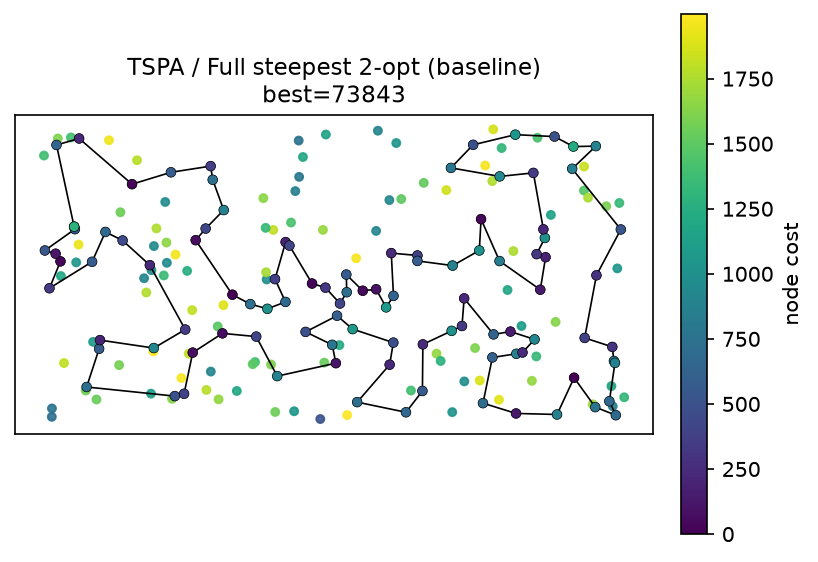
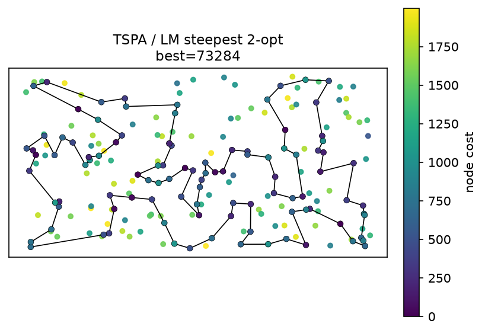
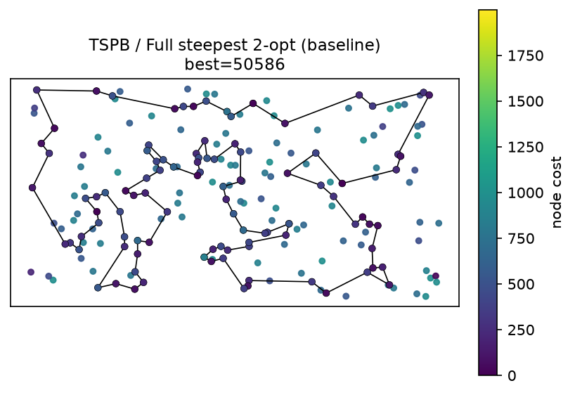
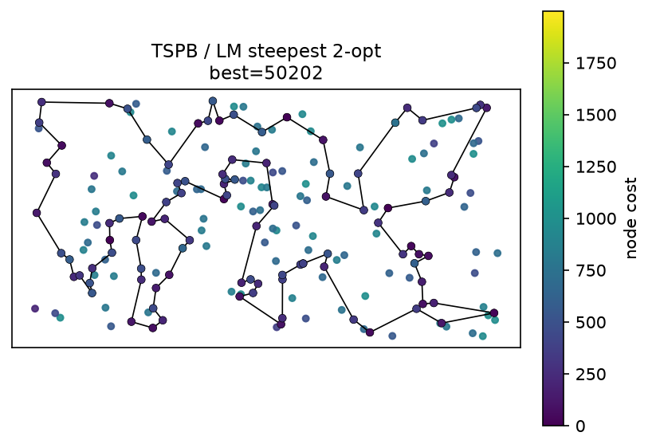

# Lab 5 — List of Improving Moves in Steepest Local Search for Selective TSP with Node Costs

Authors: Wiktor Talarek 160225, Daniel Skalski 160261

This notebook implements the Lab 5 assignment: improve the time efficiency of the **steepest local search**
by reusing move evaluations (deltas) from previous iterations through a **list of improving moves (LM)**.
The neighbourhood is the one that proved best in Lab 3 / used in Lab 4: **2-opt intra-route moves +
inter-route node exchange**. The baseline is the full steepest local search without the LM mechanism.

## 1. Description of the problem

We are given a set of `n = 200` nodes (instances `TSPA`, `TSPB` in `data/TSPA.csv`, `data/TSPB.csv`).:

- `(x, y)` — position in the plane,
- `cost[i] >= 0` — price paid if node `i` is visited.

Goal: **select exactly `k = ceil(n / 2) = 100` nodes and find a Hamiltonian cycle** through them minimizing:

```
f(tour) = sum_i dist[tour[i], tour[(i+1) mod k]] + sum_i cost[tour[i]]
```

where `dist` is the Euclidean distance **rounded to the nearest integer**:

```
dist[i,j] = round(sqrt((x_i-x_j)^2 + (y_i-y_j)^2))
```

Methodological constraints (same as in Labs 1-4):

- The distance matrix is precomputed once after loading the instance.
- Optimization methods access only `dist` and `costs`, never `(x, y)`. Coordinates are used only for
  visualization.
- Every move delta is computed in `O(1)`; no neighbour solution is built explicitly and the objective
  is never recomputed from scratch inside the search.

This is a **Selective / Orienteering-like TSP**: subset selection and permutation are optimized jointly.

## 2. Implemented algorithms — pseudocode

Common notation: `n` nodes, select `k`, `D` distance matrix, `C` node costs, `used[]` visited flag,
`tour[]` the current cyclic tour.

The neighbourhood is **2-opt intra-route moves + inter-route node exchange** (the best Lab 3 neighbourhood,
reused in Lab 4).

### 2.1 Baseline: full steepest local search

```text
STEEPEST_FULL(tour, used, D, C, k, n):
    repeat:
        best_delta <- 0; best_move <- none
        # inter-route: exchange one selected node with one unselected node
        for each selected position p and each unselected node u:
            d <- D[prev(p),u] + D[u,next(p)] - D[prev(p),tour[p]] - D[tour[p],next(p)] + C[u] - C[tour[p]]
            if d < best_delta: best_delta <- d; best_move <- (inter, p, u)
        # intra-route: 2-opt
        for each non-adjacent pair (i,j):
            d <- D[tour[i],tour[j]] + D[tour[i+1],tour[j+1]] - D[tour[i],tour[i+1]] - D[tour[j],tour[j+1]]
            if d < best_delta: best_delta <- d; best_move <- (2opt, i, j)
        if best_move is none: break
        apply best_move; cost <- cost + best_delta
    return tour, cost
```

The whole neighbourhood (`k(n-k) = 10 000` inter-route + `4 850` 2-opt deltas per iteration) is scanned
at every iteration.

### 2.2 Steepest local search with a list of improving moves (LM)

LM keeps improving moves sorted from the best (most negative delta) to the worst. Each move stores the two
edges it removes (with their saved direction) and enough information to apply it.

When a saved move is browsed, three situations are distinguished (the removed edges are the ones defining
the saved move):

1. **Removed edges no longer exist in the current solution (at least one of them)** — remove the move from LM.
2. **Removed edges exist in a different relative direction** than saved — leave the move in LM, do not apply
   it, keep browsing.
3. **Removed edges exist in the same relative direction (both reversed is also fine)** — apply the move and
   remove it from LM.

For an inter-route node exchange the move also requires the incoming node `u` to be currently unselected;
if `u` was selected by a later move the saved move is stale and is removed from LM (case 1).

```text
LM_STEEPEST(tour, used, D, C, k, n):
    LM <- empty list of improving moves, sorted by delta ascending
    Generate an initial solution x
    Evaluate all moves applicable to x; add every improving move (delta < 0) to LM
    repeat:
        for moves m from LM starting from the best until an applicable move is found:
            Check if m is applicable (the 3 cases above); if not, remove it from LM
            if an applicable move m has been found:
                x <- m(x); cost <- cost + delta(m); remove m from LM
                (restart scanning LM from the best)
        if no applicable move was found:
            Evaluate all moves applicable to x; replace LM with the improving moves found
    until LM is empty
    return x, cost
```

New moves are evaluated with their edges in the direction they appear in the current tour, so moves whose
edges were reversed by a previous 2-opt are matched by case 3 ("both reversed"). 

The only randomness is the random starting solution (`k` distinct nodes sampled uniformly without
replacement and shuffled).

## 3. Computational experiment

For each instance, 200 random starting solutions are generated with a fixed seed and reused by every
method (paired comparison). Each method is run 200 times. Times are total wall-clock seconds for the 200
runs and include random-start construction. The baseline is the full steepest local search without the LM
mechanism.

### 3.1 Results: objective function, mean (min-max)

| Method | TSPA | TSPB |
| :--- | :--- | :--- |
| Full steepest 2-opt (baseline) | **76278.1** (73843-79671) | 52598.8 (50586-55376) |
| LM steepest 2-opt | 76679.1 (**73284**-80508) | 52708.5 (**50202**-55616) |

### 3.2 Results: running time and evaluated moves, per 200 runs

| Method | TSPA total [s] | TSPB total [s] | TSPA evals/run | TSPB evals/run |
| :--- | :--- | :--- | :--- | :--- |
| Full steepest 2-opt (baseline) | 1.5253 | 1.8633 | 1 997 116 | 2 004 244 |
| LM steepest 2-opt | 0.2556 | 0.2511 | 175 453 | 171 518 |


## 4. Visualization of the best solutions

Node colour encodes the node cost. The colour scale is the same in every figure
(`viridis`, global minimum and maximum node cost over both instances), and every figure has its own
colorbar with the actual cost values. Background dots are all 200 nodes; the selected 100 nodes are
coloured points with a black edge, connected by a closed black polyline.

### TSPA

#### Full steepest 2-opt (baseline) — best = 73843



#### LM steepest 2-opt — best = 73284



### TSPB

#### Full steepest 2-opt (baseline) — best = 50586



#### LM steepest 2-opt — best = 50202



## 5. Best solutions as node index lists (0-based)

### TSPA

**Full steepest 2-opt (baseline):** cost=73843

```python
[82, 31, 48, 80, 91, 157, 71, 4, 76, 132, 180, 28, 102, 185, 35, 51, 16, 67, 144, 53, 179, 52, 177, 36, 99, 131, 33, 9, 54, 8, 142, 164, 85, 93, 50, 3, 169, 1, 178, 184, 186, 136, 163, 29, 17, 55, 101, 147, 47, 130, 159, 146, 170, 153, 78, 88, 107, 64, 57, 182, 151, 42, 89, 113, 106, 150, 174, 176, 72, 134, 158, 192, 181, 58, 84, 41, 140, 45, 73, 135, 98, 87, 141, 187, 2, 171, 69, 127, 97, 161, 30, 123, 152, 108, 49, 168, 63, 149, 116, 60]
```

**LM steepest 2-opt:** cost=73284

```python
[51, 16, 35, 156, 180, 28, 102, 185, 67, 144, 45, 135, 73, 140, 53, 179, 52, 177, 36, 33, 9, 54, 8, 174, 176, 150, 106, 85, 142, 164, 186, 136, 163, 29, 178, 1, 169, 3, 50, 93, 47, 130, 159, 146, 170, 153, 193, 78, 88, 107, 89, 42, 151, 57, 182, 111, 192, 158, 134, 84, 58, 181, 114, 25, 98, 87, 141, 30, 187, 2, 171, 104, 129, 69, 127, 97, 95, 168, 63, 149, 116, 60, 49, 108, 152, 160, 83, 123, 90, 132, 76, 38, 80, 31, 48, 91, 157, 71, 112, 139]
```

### TSPB

**Full steepest 2-opt (baseline):** cost=50586

```python
[66, 24, 34, 25, 98, 151, 122, 3, 184, 46, 72, 117, 8, 120, 133, 136, 172, 160, 69, 189, 183, 130, 191, 30, 21, 38, 154, 140, 47, 64, 40, 141, 60, 157, 45, 134, 175, 62, 71, 155, 97, 26, 125, 177, 170, 115, 6, 197, 29, 132, 65, 145, 28, 149, 37, 116, 147, 121, 198, 96, 48, 43, 156, 89, 57, 190, 70, 94, 105, 196, 114, 10, 54, 104, 76, 162, 192, 80, 127, 129, 90, 153, 20, 14, 2, 74, 171, 99, 179, 87, 82, 51, 85, 107, 59, 73, 167, 181, 152, 67]
```

**LM steepest 2-opt:** cost=50202

```python
[24, 66, 67, 99, 171, 74, 2, 110, 14, 20, 153, 52, 90, 129, 127, 80, 192, 54, 78, 10, 114, 196, 105, 94, 81, 70, 190, 194, 104, 162, 76, 185, 57, 89, 156, 48, 96, 58, 198, 121, 130, 50, 147, 116, 37, 146, 149, 28, 145, 65, 178, 103, 132, 29, 36, 197, 6, 115, 170, 125, 26, 154, 97, 155, 71, 175, 134, 45, 157, 60, 40, 33, 64, 47, 140, 38, 21, 30, 183, 69, 160, 172, 8, 136, 133, 120, 72, 184, 3, 151, 59, 73, 167, 51, 85, 87, 179, 181, 152, 34]
```

## 6. Solution checking

All four best tours were verified for correctness (length `k = 100`, distinct nodes, indices in range)
and the stored cost was recomputed from the tour. The best solutions are also saved as paste-ready
node-id lists in:

- `solutions/lab5_TSPA_baseline_full_ids.csv`
- `solutions/lab5_TSPA_lm_steepest_ids.csv`
- `solutions/lab5_TSPB_baseline_full_ids.csv`
- `solutions/lab5_TSPB_lm_steepest_ids.csv`

Checker output from the notebook:

```text
TSPA/baseline_full: ok=True recomputed_cost=73843 stored=73843 match=True
TSPA/lm_steepest: ok=True recomputed_cost=73284 stored=73284 match=True
TSPB/baseline_full: ok=True recomputed_cost=50586 stored=50586 match=True
TSPB/lm_steepest: ok=True recomputed_cost=50202 stored=50202 match=True
```

## 7. Source code

https://github.com/skalskidaniel/evolutionary-computation/blob/main/lab5.ipynb

## 8. Conclusions

1. **The LM mechanism reuses previously evaluated deltas.** Instead of rescanning the full neighbourhood
   at every iteration, the search keeps a list of improving moves (LM) ordered from best to worst and
   applies the first applicable move. Stale moves (whose removed edges disappeared, or whose incoming
   node was already selected) are removed from LM (case 1); moves whose edges appear in a different
   relative direction are kept for later (case 2); moves whose edges exist in the same relative direction
   are applied and removed (case 3). A full neighbourhood re-evaluation is performed only when LM no
   longer contains an applicable move.

2. **Time efficiency.**  LM is much faster, obtaining average times: TSPA
   0.2556 s vs 1.5253 s and TSPB 0.2511 s vs 1.8633 s, while evaluating ~11x fewer move deltas per run
   (175453 vs 1997116 on TSPA; 171518 vs 2004244 on TSPB).

3. **Solution quality.** LM reaches essentially the same quality as the baseline, and on both instances
   it finds a slightly better best solution (TSPA: 73284 vs 73843; TSPB: 50202 vs 50586) while the mean
   is comparable (within ~0.5-0.6%).


