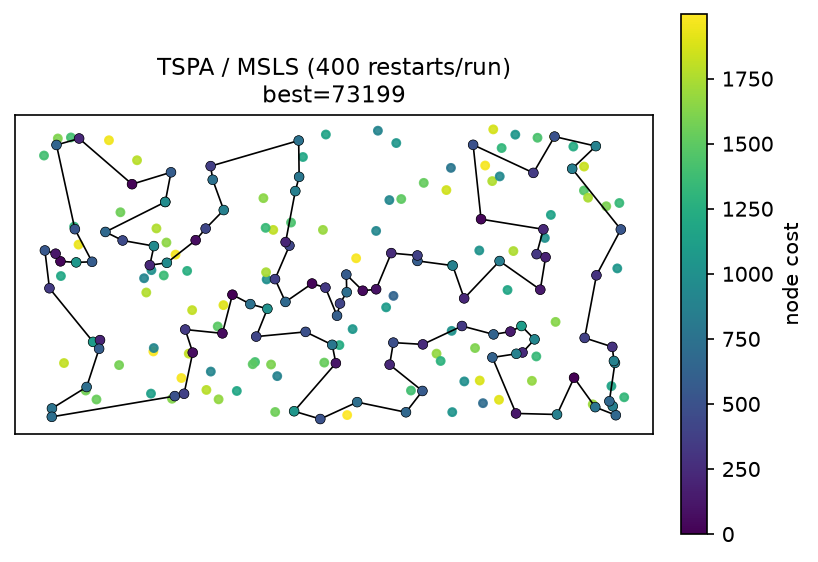
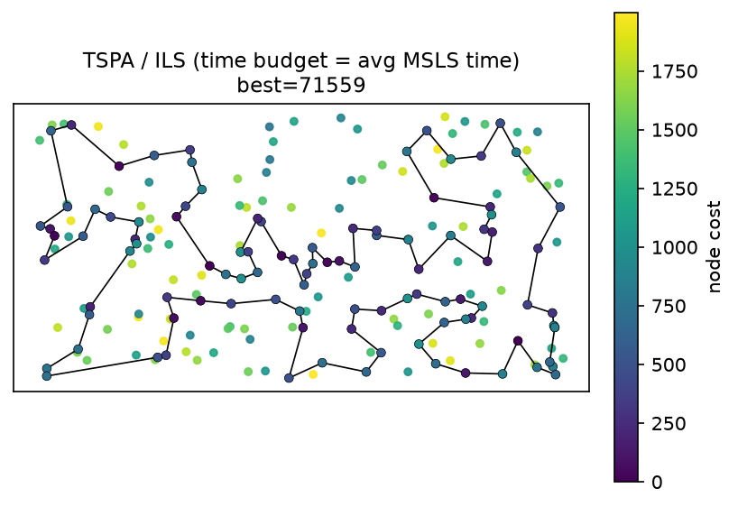
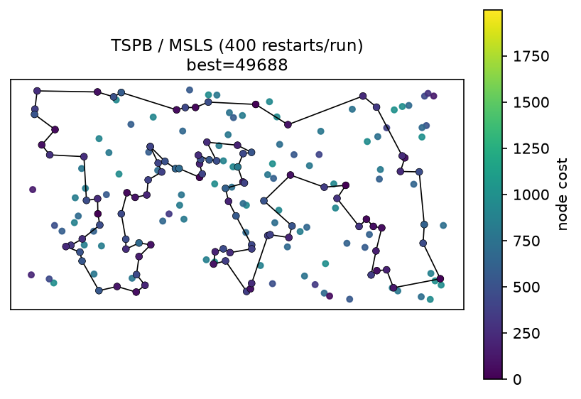
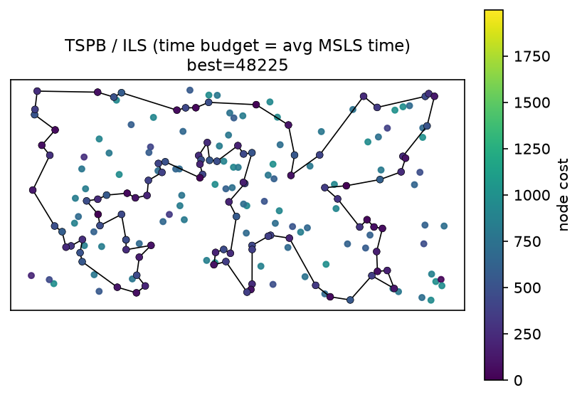

# Lab 6 — Multiple Start Local Search (MSLS) and Iterated Local Search (ILS)

Authors: Wiktor Talarek 160225, Daniel Skalski 160261

This notebook implements the Lab 6 assignment: two simple extensions of local search for the **selective TSP with node costs**:

* **Multiple start local search (MSLS)** — steepest local search started from random solutions; a single MSLS run keeps the best among 400 basic local-search runs.
* **Iterated local search (ILS)** — a random start is locally searched, then a perturbation kick is applied and the search is repeated until the time budget (the average running time of one MSLS run) is exhausted.

The basic local search is the **list-of-improving-moves (LM) steepest local search** developed in Lab 5. The perturbation used in ILS is designed here and described precisely below.

## 1. Description of the problem

We are given a set of `n = 200` nodes (instances `TSPA`, `TSPB` in `data/TSPA.csv`, `data/TSPB.csv`). 

- `(x, y)` — position in the plane,
- `cost[i] >= 0` — price paid if node `i` is visited.

Goal: **select exactly `k = ceil(n / 2) = 100` nodes and find a Hamiltonian cycle** through them minimizing:

```
f(tour) = sum_i dist[tour[i], tour[(i+1) mod k]] + sum_i cost[tour[i]]
```

where `dist` is the Euclidean distance rounded to the nearest integer:

```
dist[i,j] = round(sqrt((x_i-x_j)^2 + (y_i-y_j)^2))
```

Methodological constraints (same as in Labs 1-5):

- The distance matrix is precomputed once after loading the instance.
- Optimization methods access only `dist` and `costs`, never `(x, y)`. Coordinates are used only for visualization.
- Every move delta is computed in `O(1)`; no neighbour solution is built explicitly and the objective is never recomputed from scratch inside the search.

This is a **Selective / Orienteering-like TSP**: subset selection and permutation are optimized jointly.

## 2. Implemented algorithms — pseudocode

Common notation: `n` nodes, select `k`, `D` distance matrix, `C` node costs, `used[]` visited flag, `tour[]` the current cyclic tour.

The neighbourhood is **2-opt intra-route moves + inter-route node exchange**.

### 2.1 Basic local search: steepest with a list of improving moves (LM)

LM keeps improving moves sorted from the best (most negative delta) to the worst. Each move stores the two edges it removes (with their saved direction). When a saved move is browsed, three situations are distinguished:

1. **Removed edges no longer exist in the current solution** — remove the move from LM.
2. **Removed edges exist in a different relative direction** — leave the move in LM, do not apply it, keep browsing.
3. **Removed edges exist in the same relative direction (both reversed is also fine)** — apply the move and remove it from LM.

For an inter-route node exchange the move also requires the incoming node `u` to be currently unselected. A full neighbourhood re-evaluation is performed only when LM no longer contains an applicable move.

### 2.2 Multiple start local search (MSLS)

```text
MSLS(D, C, k, n, rng, restarts = 400):
    best <- infinity
    repeat restarts times:
        init <- random solution (k distinct nodes, shuffled)
        tour, cost <- STEEPEST_LM(init)
        if cost < best: best <- cost; best_tour <- tour
    return best_tour, best
```

### 2.3 Iterated local search (ILS)

```text
ILS(D, C, k, n, rng, time_budget):
    init <- random solution
    tour, cost <- STEEPEST_LM(init)
    best <- (tour, cost)
    while elapsed < time_budget:
        ptour <- PERTURB(tour)          # perturbation kick
        qtour, qcost <- STEEPEST_LM(ptour)
        if qcost < cost:                # hill-climbing acceptance
            tour, cost <- qtour, qcost
            if cost < best.cost: best <- (tour, cost)
    return best
```

The stopping condition is the time budget equal to the average running time of a single MSLS run.

### 2.4 Perturbation used in ILS (node-exchange kick)

From the current tour, remove `r` nodes at uniformly random positions (they become unselected) and reinsert `r` nodes drawn uniformly at random from the currently unselected nodes, each at a uniformly random position in the tour. Both the subset and the order are changed, which kicks the search out of the current local optimum, while the kick is kept moderate (`r = 5` out of `k = 100` nodes) so the subsequent local search can still exploit the structure of the incumbent. The parameter `r` controls the strength of the kick: small `r` behaves like a refined multi-start, large `r` approaches a random restart.

### 2.5 Acceptance

Standard hill-climbing ILS: the perturbed and locally re-optimised solution is accepted iff it is strictly better than the current incumbent. The best solution ever seen is tracked separately.

## 3. Computational experiment

Run each method (MSLS, ILS) `NUM_RUNS = 20` times per instance. MSLS performs `MSLS_RESTARTS = 400` basic local-search runs per run and keeps the best. For ILS the stopping condition is the average running time of a single MSLS run; each ILS run starts from a random solution. The number of basic local-search runs performed within each ILS run is also reported.

## 4. Results

### 4.1 Objective function: mean (min-max), 20 runs per instance

| Instance | Method | mean | min | max |
|:---|:---|---:|---:|---:|
| TSPA | MSLS (400 restarts/run) | 73810.6 | 73199 | 74143 |
| TSPA | ILS (time budget = avg MSLS time) | 71788.6 | 71559 | 72213 |
| TSPB | MSLS (400 restarts/run) | 50284.1 | 49688 | 50714 |
| TSPB | ILS (time budget = avg MSLS time) | 48446.8 | 48225 | 48966 |

### 4.2 Running time, 20 runs per instance

| Instance | Method | total [s] | per run [s] |
|:---|:---|---:|---:|
| TSPA | MSLS (400 restarts/run) | 434.10 | 21.705 |
| TSPA | ILS (time budget = avg MSLS time) | 434.93 | 21.747 |
| TSPB | MSLS (400 restarts/run) | 481.57 | 24.078 |
| TSPB | ILS (time budget = avg MSLS time) | 482.80 | 24.140 |

### 4.3 ILS: number of runs of basic local search

| Instance | Method | budget [s] | LS runs/ILS run (mean) | LS runs/ILS run (min) | LS runs/ILS run (max) |
|:---|:---|---:|---:|---:|---:|
| TSPA | ILS (time budget = avg MSLS time) | 21.71 | 7879.2 | 7054 | 9895 |
| TSPB | ILS (time budget = avg MSLS time) | 24.08 | 10090.2 | 8950 | 11586 |

### 4.4 Reference values from previous labs (200 runs, not part of the 20-run experiment)

| Instance | Method | mean | min | max |
|:---|:---|---:|---:|---:|
| TSPA | Best local search (lm_steepest, Lab 5, ref) | 76679.1 | 73284 | 80508 |
| TSPA | Full steepest 2-opt (baseline, Lab 5, ref) | 76278.1 | 73843 | 79671 |
| TSPB | Best local search (lm_steepest, Lab 5, ref) | 52708.5 | 50202 | 55616 |
| TSPB | Full steepest 2-opt (baseline, Lab 5, ref) | 52598.8 | 50586 | 55376 |

ILS improves on MSLS on both instances, and its best solutions (TSPA 71559, TSPB 48225) improve on the best local search from Lab 5 (lm_steepest: TSPA 73284, TSPB 50202) and on the Lab 5 baseline (full steepest 2-opt: TSPA 73843, TSPB 50586).

## 5. Visualization of the best solutions

Node colour encodes the node cost. **The colour scale is identical in every figure** (`viridis`, global minimum and maximum node cost over both instances), so colours are comparable across figures; every figure has its own colorbar with the actual cost values. Background dots are all 200 nodes; the selected 100 nodes are coloured points with a black edge, connected by a closed black polyline.

**The figures are shown separately, one below another.**

### TSPA

#### MSLS (400 restarts/run) — best = 73199



#### ILS (time budget = avg MSLS time) — best = 71559



### TSPB

#### MSLS (400 restarts/run) — best = 49688



#### ILS (time budget = avg MSLS time) — best = 48225



## 6. Best solutions as node index lists 

Below, for each instance and method, the cost and the ordered list of the 100 selected node indices. The lists are also saved to `solutions/lab6_{instance}_{method}_ids.csv` (one node id per line).

### TSPA

**MSLS (400 restarts/run):** cost=73199

```
[38, 91, 80, 48, 31, 60, 49, 11, 63, 149, 116, 168, 95, 97, 127, 69, 129, 104, 171, 2, 187, 30, 141, 180, 28, 102, 87, 45, 73, 135, 25, 114, 181, 192, 158, 58, 84, 134, 176, 150, 106, 43, 113, 89, 42, 151, 57, 64, 107, 88, 78, 193, 153, 170, 146, 159, 130, 47, 147, 101, 55, 29, 178, 136, 164, 1, 3, 50, 93, 85, 174, 8, 54, 9, 33, 36, 177, 52, 179, 53, 140, 144, 67, 185, 35, 16, 51, 139, 112, 115, 157, 71, 4, 76, 132, 90, 123, 100, 152, 108]
```

**ILS (time budget = avg MSLS time):** cost=71559

```
[170, 146, 159, 130, 47, 147, 101, 29, 178, 184, 136, 186, 164, 1, 169, 3, 50, 93, 85, 174, 8, 54, 9, 33, 131, 36, 177, 52, 179, 53, 140, 144, 67, 16, 51, 156, 35, 185, 102, 28, 180, 132, 76, 4, 71, 157, 91, 80, 48, 31, 60, 116, 149, 63, 168, 49, 108, 152, 100, 123, 83, 160, 97, 127, 69, 129, 104, 171, 2, 187, 30, 141, 87, 45, 73, 135, 114, 181, 192, 158, 58, 84, 134, 72, 176, 150, 106, 113, 89, 42, 151, 138, 182, 57, 64, 107, 88, 78, 193, 153]
```

### TSPB

**MSLS (400 restarts/run):** cost=49688

```
[130, 183, 189, 168, 69, 160, 172, 136, 133, 8, 117, 120, 72, 86, 46, 137, 184, 3, 122, 151, 98, 152, 181, 167, 73, 59, 85, 51, 82, 87, 179, 34, 24, 67, 66, 27, 76, 162, 54, 192, 80, 127, 129, 90, 153, 74, 20, 14, 2, 110, 118, 56, 148, 10, 114, 196, 70, 190, 57, 89, 48, 96, 198, 121, 42, 147, 116, 37, 146, 13, 149, 28, 145, 158, 177, 125, 170, 115, 6, 29, 132, 197, 36, 62, 175, 134, 45, 157, 60, 40, 141, 71, 155, 97, 154, 140, 47, 38, 21, 30]
```

**ILS (time budget = avg MSLS time):** cost=48225

```
[155, 71, 40, 60, 157, 45, 134, 175, 36, 197, 6, 29, 132, 103, 178, 65, 145, 28, 149, 13, 146, 37, 116, 147, 42, 121, 198, 96, 48, 89, 57, 185, 76, 104, 190, 70, 81, 94, 105, 61, 196, 114, 10, 78, 54, 162, 192, 80, 127, 129, 90, 153, 20, 14, 2, 74, 17, 171, 99, 67, 24, 34, 152, 181, 179, 87, 82, 51, 85, 59, 73, 167, 98, 151, 3, 184, 86, 46, 72, 117, 8, 120, 133, 136, 172, 160, 69, 183, 30, 21, 38, 47, 140, 154, 26, 125, 177, 170, 115, 97]
```

## 7. Solution checking

All best tours are verified for correctness (length `k = 100`, distinct nodes, indices in range) and the stored cost is recomputed from the tour.

Checker output from the notebook:

```text
TSPA/msls: ok=True (ok) recomputed_cost=73199 stored=73199 match=True
TSPA/ils: ok=True (ok) recomputed_cost=71559 stored=71559 match=True
TSPB/msls: ok=True (ok) recomputed_cost=49688 stored=49688 match=True
TSPB/ils: ok=True (ok) recomputed_cost=48225 stored=48225 match=True
```

## 8. Source code

The implementation is in `lab6.py` (this notebook mirrors it) and uses the LM steepest local search from `lab5.ipynb` (Lab 5) as the basic local search.

## 9. Conclusions

1. **MSLS vs ILS.** On both instances ILS obtains a clearly better mean and best solution than MSLS within the same average running time per run (TSPA: ILS mean 71788.6 vs MSLS mean 73810.6; best 71559 vs 73199. TSPB: ILS mean 48446.8 vs MSLS mean 50284.1; best 48225 vs 49688). The goal of obtaining better results with ILS than with MSLS is achieved.

2. **ILS beats the earlier best methods.** The best ILS solutions (TSPA 71559, TSPB 48225) improve on the best local search from Lab 5 (lm_steepest: TSPA 73284, TSPB 50202) and on the Lab 5 baseline full steepest local search (TSPA 73843, TSPB 50586).

3. **Perturbation.** The node-exchange kick (remove `r = 5` random tour nodes, reinsert `r` random unselected nodes at random positions) is strong enough to escape local optima but moderate enough that the following LM local search still exploits the incumbent's structure. Each ILS run performs several thousand basic local-search runs within the time budget (TSPA: ~7879, TSPB: ~10090 on average).


